# DevOps Engineering — Master Learning Index
### From Zero to Production-Ready | Gold Standard Curriculum

> **Purpose:** A comprehensive, structured index covering every topic, subtopic, concept, and skill required to become a proficient DevOps Engineer — from absolute prerequisites to advanced specializations.
>
> **Audience:** Universal — Engineers, students, teams, and organizations.
>
> **Standard:** Industry-aligned with roadmap.sh, CNCF landscape, AWS/Azure/GCP certifications, and Google SRE practices.

---

## Table of Contents

- [How to Use This Index](#how-to-use-this-index)
- [Overall Roadmap](#overall-roadmap)
- [Phase 0 — Prerequisites](#phase-0--prerequisites)
  - [0.1 Computer Science Fundamentals](#01-computer-science-fundamentals)
  - [0.2 Programming Language (Pick One)](#02-programming-language-pick-one)
  - [0.3 Data Formats & Serialization](#03-data-formats--serialization)
- [Phase 1 — Operating Systems & Linux](#phase-1--operating-systems--linux)
  - [1.1 Operating System Concepts](#11-operating-system-concepts)
  - [1.2 Linux Fundamentals](#12-linux-fundamentals)
  - [1.3 Shell & Bash Scripting](#13-shell--bash-scripting)
  - [1.4 System Administration](#14-system-administration)
- [Phase 2 — Networking & Security Fundamentals](#phase-2--networking--security-fundamentals)
  - [2.1 Networking Theory (OSI & TCP/IP)](#21-networking-theory-osi--tcpip)
  - [2.2 Protocols & Services](#22-protocols--services)
  - [2.3 Network Troubleshooting Tools](#23-network-troubleshooting-tools)
  - [2.4 Firewalls, Proxies & Load Balancers](#24-firewalls-proxies--load-balancers)
  - [2.5 SSL/TLS & Cryptography Basics](#25-ssltls--cryptography-basics)
- [Phase 3 — Version Control (Git)](#phase-3--version-control-git)
  - [3.1 Git Fundamentals](#31-git-fundamentals)
  - [3.2 Branching Strategies](#32-branching-strategies)
  - [3.3 Collaboration & Code Review](#33-collaboration--code-review)
  - [3.4 Git Hosting Platforms](#34-git-hosting-platforms)
- [Phase 4 — Containers & Docker](#phase-4--containers--docker)
  - [4.1 Containerization Concepts](#41-containerization-concepts)
  - [4.2 Docker Fundamentals](#42-docker-fundamentals)
  - [4.3 Dockerfile Mastery](#43-dockerfile-mastery)
  - [4.4 Docker Compose](#44-docker-compose)
  - [4.5 Docker Networking & Volumes](#45-docker-networking--volumes)
  - [4.6 Container Registries](#46-container-registries)
  - [4.7 Container Security](#47-container-security)
- [Phase 5 — Web Servers & Server Management](#phase-5--web-servers--server-management)
  - [5.1 Web Server Fundamentals](#51-web-server-fundamentals)
  - [5.2 Nginx Deep Dive](#52-nginx-deep-dive)
  - [5.3 Reverse Proxy & Load Balancing](#53-reverse-proxy--load-balancing)
  - [5.4 Caching Strategies](#54-caching-strategies)
- [Phase 6 — CI/CD Pipelines](#phase-6--cicd-pipelines)
  - [6.1 CI/CD Concepts](#61-cicd-concepts)
  - [6.2 Pipeline Design](#62-pipeline-design)
  - [6.3 CI/CD Tools](#63-cicd-tools)
  - [6.4 Artifact Management](#64-artifact-management)
  - [6.5 Testing in Pipelines](#65-testing-in-pipelines)
  - [6.6 Progressive Delivery & Feature Flags](#66-progressive-delivery--feature-flags)
- [Phase 7 — Cloud Computing](#phase-7--cloud-computing)
  - [7.1 Cloud Fundamentals](#71-cloud-fundamentals)
  - [7.2 AWS Core Services](#72-aws-core-services)
  - [7.3 Azure Core Services](#73-azure-core-services)
  - [7.4 GCP Core Services](#74-gcp-core-services)
  - [7.5 Multi-Cloud & Cloud-Agnostic Patterns](#75-multi-cloud--cloud-agnostic-patterns)
- [Phase 8 — Infrastructure as Code (IaC)](#phase-8--infrastructure-as-code-iac)
  - [8.1 IaC Concepts](#81-iac-concepts)
  - [8.2 Terraform](#82-terraform)
  - [8.3 Configuration Management (Ansible)](#83-configuration-management-ansible)
  - [8.4 Other IaC Tools](#84-other-iac-tools)
  - [8.5 IaC Testing & Validation](#85-iac-testing--validation)
- [Phase 9 — Container Orchestration (Kubernetes)](#phase-9--container-orchestration-kubernetes)
  - [9.1 Kubernetes Architecture](#91-kubernetes-architecture)
  - [9.2 Core Objects & Workloads](#92-core-objects--workloads)
  - [9.3 Networking in Kubernetes](#93-networking-in-kubernetes)
  - [9.4 Storage & State Management](#94-storage--state-management)
  - [9.5 Helm & Package Management](#95-helm--package-management)
  - [9.6 Kubernetes Security (RBAC, Policies)](#96-kubernetes-security-rbac-policies)
  - [9.7 Kubernetes Operations](#97-kubernetes-operations)
  - [9.8 Kubernetes Operators & CRDs](#98-kubernetes-operators--crds)
  - [9.9 Service Mesh Deep Dive](#99-service-mesh-deep-dive)
- [Phase 10 — Monitoring, Logging & Observability](#phase-10--monitoring-logging--observability)
  - [10.1 Observability Concepts (Three Pillars)](#101-observability-concepts-three-pillars)
  - [10.2 Metrics — Prometheus & Grafana](#102-metrics--prometheus--grafana)
  - [10.3 Logging — ELK / Loki](#103-logging--elk--loki)
  - [10.4 Tracing — Jaeger / OpenTelemetry](#104-tracing--jaeger--opentelemetry)
  - [10.5 Alerting & Incident Response](#105-alerting--incident-response)
- [Phase 11 — Security (DevSecOps)](#phase-11--security-devsecops)
  - [11.1 Security Mindset & Principles](#111-security-mindset--principles)
  - [11.2 Secrets Management](#112-secrets-management)
  - [11.3 Image & Code Scanning](#113-image--code-scanning)
  - [11.3A Supply Chain Security](#113a-supply-chain-security)
  - [11.3B Runtime Security](#113b-runtime-security)
  - [11.4 Network Security](#114-network-security)
  - [11.5 Compliance & Auditing](#115-compliance--auditing)
- [Phase 12 — Databases for DevOps](#phase-12--databases-for-devops)
  - [12.1 RDBMS Fundamentals](#121-rdbms-fundamentals)
  - [12.2 NoSQL Databases](#122-nosql-databases)
  - [12.3 Database Operations](#123-database-operations)
- [Phase 13 — Software Engineering Practices](#phase-13--software-engineering-practices)
  - [13.1 SDLC & Agile/Scrum](#131-sdlc--agilescrum)
  - [13.2 System Design Fundamentals](#132-system-design-fundamentals)
  - [13.3 Documentation & Communication](#133-documentation--communication)
  - [13.4 SRE Practices](#134-sre-practices)
- [Phase 14 — Advanced & Emerging Fields](#phase-14--advanced--emerging-fields)
  - [14.1 GitOps](#141-gitops)
  - [14.2 Platform Engineering](#142-platform-engineering)
  - [14.3 Chaos Engineering](#143-chaos-engineering)
  - [14.4 MLOps](#144-mlops)
  - [14.5 LLMOps](#145-llmops)
  - [14.6 DataOps](#146-dataops)
  - [14.7 Edge & IoT DevOps](#147-edge--iot-devops)
  - [14.8 FinOps (Cloud Cost Optimization)](#148-finops-cloud-cost-optimization)
- [Appendix A — Certifications Roadmap](#appendix-a--certifications-roadmap)
- [Appendix B — Recommended Books](#appendix-b--recommended-books)
- [Appendix C — Hands-On Project Ideas](#appendix-c--hands-on-project-ideas)
- [Appendix D — Tool Landscape Map](#appendix-d--tool-landscape-map)
- [Appendix E — DevOps Job Market Research (2025–2026)](#appendix-e--devops-job-market-research-20252026)

---

## How to Use This Index

```
Symbols used throughout:
  📖  Theory / Concept to understand
  🔧  Hands-on skill / Tool to practice
  📐  Architecture / Design pattern
  ⚡  Key point — frequently asked in interviews
  🔗  Reference link for deeper study
```

**Recommended approach:** Follow phases sequentially. Each phase builds on the previous. Within each phase, topics are ordered by dependency.

---

## Prerequisite Dependency Matrix

> Before starting a phase, ensure you have completed its prerequisites. This matrix prevents gaps.

| Phase | Name | Hard Prerequisites | Soft Prerequisites (Helpful) |
|---|---|---|---|
| **0** | CS Fundamentals | — (Start here) | Any programming exposure |
| **1** | OS & Linux | Phase 0 | — |
| **2** | Networking & Security | Phase 0, Phase 1 | — |
| **3** | Version Control (Git) | Phase 0 | Phase 1 (CLI familiarity) |
| **4** | Containers (Docker) | Phase 1, Phase 3 | Phase 2 (networking basics for port mapping) |
| **5** | Web Servers (Nginx) | Phase 2, Phase 4 | — |
| **6** | CI/CD Pipelines | Phase 3, Phase 4 | Phase 5 (deployment targets) |
| **7** | Cloud Computing | Phase 2, Phase 4 | Phase 5, Phase 6 |
| **8** | Infrastructure as Code | Phase 7 | Phase 1 (SSH), Phase 6 (automation mindset) |
| **9** | Kubernetes | Phase 4, Phase 7 | Phase 2 (networking), Phase 8 (IaC thinking) |
| **10** | Observability | Phase 4, Phase 9 | Phase 5 (Nginx logs/metrics) |
| **11** | DevSecOps | Phase 4, Phase 6, Phase 9 | Phase 2 (TLS), Phase 7 (IAM) |
| **12** | Databases | Phase 1, Phase 3 | Phase 4 (containerized DBs) |
| **13** | SW Engineering / SRE | Phase 6, Phase 10 | Phase 9, Phase 11 |
| **14** | Advanced (GitOps, MLOps) | Phase 9, Phase 13 | Phase 8, Phase 10, Phase 11 |

> **Reading the matrix:** "Hard Prerequisites" = must-have knowledge. "Soft Prerequisites" = makes learning smoother but not blocking.

---

## Overall Roadmap

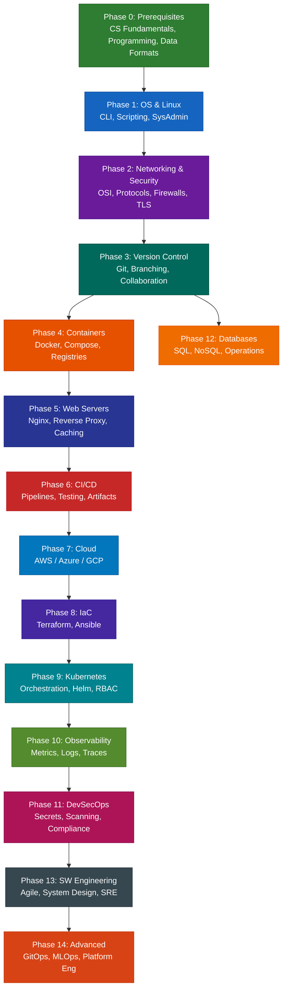

---

## Phase 0 — Prerequisites

### 0.1 Computer Science Fundamentals

| # | Topic | Subtopics | Key Concepts |
|---|---|---|---|
| 0.1.1 | 📖 How Computers Work | CPU, RAM, Storage, I/O | Von Neumann architecture, clock cycles, instruction sets |
| 0.1.2 | 📖 Binary & Number Systems | Binary, Octal, Hex, ASCII, Unicode | Bit, Byte, KB/MB/GB, base conversion |
| 0.1.3 | 📖 Data Structures (Basics) | Arrays, Lists, Dictionaries/Maps, Sets, Queues, Stacks | Time complexity (Big-O), when to use which |
| 0.1.4 | 📖 Algorithms (Basics) | Sorting, Searching, Recursion | Binary search, hash tables, why performance matters |
| 0.1.5 | 📖 Operating System Concepts | Processes, Threads, Memory, File Systems | Process lifecycle, virtual memory, paging, context switching |
| 0.1.6 | 📖 How the Internet Works | Client-Server model, DNS, HTTP, IP addressing | Request lifecycle: browser → DNS → TCP → HTTP → response |

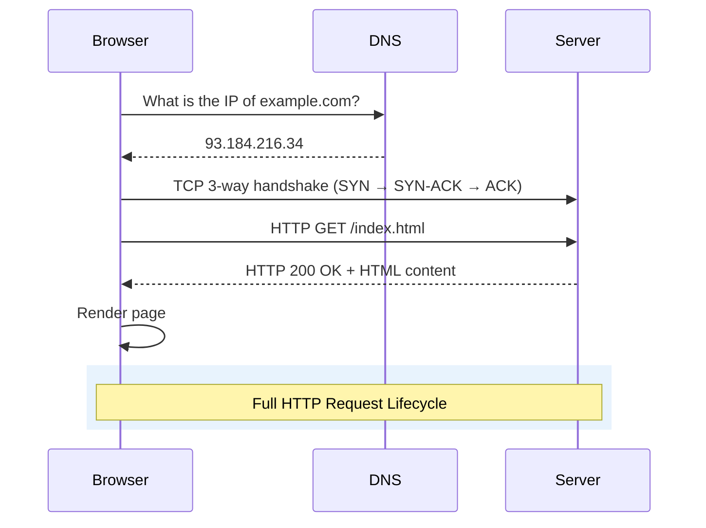

> 🔗 **References:**
> - CS50 by Harvard (free) — https://cs50.harvard.edu/
> - Operating Systems: Three Easy Pieces — https://pages.cs.wisc.edu/~remzi/OSTEP/
> - How DNS Works (visual) — https://howdns.works/

---

### 0.2 Programming Language (Pick One)

| # | Topic | Subtopics | Key Concepts |
|---|---|---|---|
| 0.2.1 | 📖 Language Selection | Python (recommended), Go, JavaScript, Bash | Python: versatile, rich ecosystem; Go: fast, cloud-native; JS: full-stack |
| 0.2.2 | 🔧 Syntax & Basics | Variables, Types, Operators, Control Flow | if/else, for/while loops, functions, return values |
| 0.2.3 | 🔧 Data Structures | Lists, Dicts, Tuples, Sets | CRUD operations, iteration, comprehensions |
| 0.2.4 | 🔧 Functions & Modules | Definition, arguments, imports, packages | DRY principle, standard library, pip/npm/go get |
| 0.2.5 | 🔧 File I/O | Read, Write, Append, CSV, JSON parsing | Context managers (`with`), encoding, error handling |
| 0.2.6 | 🔧 Error Handling | try/except, exceptions, logging | Graceful failures, stack traces, debug strategies |
| 0.2.7 | 🔧 HTTP & API Interaction | requests library, REST APIs, JSON | GET/POST/PUT/DELETE, status codes, headers, authentication |
| 0.2.8 | 🔧 Regular Expressions | Pattern matching, capture groups, substitution | `re` module, common patterns, anchors, quantifiers |
| 0.2.9 | 🔧 Automation Scripts | File management, API calls, report generation | Practical: rename bulk files, parse logs, health-check scripts |

> ⚡ **Interview Focus:** Write a script that reads a log file, extracts error lines, counts occurrences, and outputs top 10 errors.

> 🔗 **References:**
> - Automate the Boring Stuff with Python — https://automatetheboringstuff.com/
> - Go by Example — https://gobyexample.com/
> - The Modern JavaScript Tutorial — https://javascript.info/

---

### 0.3 Data Formats & Serialization

| # | Topic | Subtopics | Key Concepts |
|---|---|---|---|
| 0.3.1 | 📖 YAML | Syntax, indentation, anchors, aliases | Used in: Docker Compose, Kubernetes, Ansible, CI/CD configs |
| 0.3.2 | 📖 JSON | Objects, arrays, nesting, types | Used in: APIs, config files, Terraform state |
| 0.3.3 | 📖 TOML | Sections, key-value pairs | Used in: Python pyproject.toml, Rust cargo, config files |
| 0.3.4 | 📖 XML (Basics) | Tags, attributes, namespaces | Legacy systems, Maven POM files, SOAP APIs |
| 0.3.5 | 📖 INI / .env Files | Key-value pairs, sections | Environment variables, dotenv pattern |
| 0.3.6 | ⚡ YAML vs JSON vs TOML | Comparison: readability, comments, complexity | YAML: human-friendly; JSON: machine-friendly; TOML: simple config |

> 🔗 **References:**
> - YAML Spec v1.2 — https://yaml.org/spec/1.2.2/
> - JSON.org — https://www.json.org/
> - TOML Official Site — https://toml.io/

---

## Phase 1 — Operating Systems & Linux

### 1.1 Operating System Concepts

| # | Topic | Subtopics | Key Concepts |
|---|---|---|---|
| 1.1.1 | 📖 What is an OS | Kernel, User Space, System Calls | Abstraction layer between hardware and applications |
| 1.1.2 | 📖 Process Management | Process states, PID, Parent-Child, Orphans, Zombies | fork(), exec(), wait(), process tree, signals (SIGTERM, SIGKILL) |
| 1.1.3 | 📖 Memory Management | Virtual Memory, Paging, Swapping, OOM Killer | `free -h`, swap space, memory-mapped files |
| 1.1.4 | 📖 File Systems | ext4, xfs, btrfs, tmpfs, procfs, sysfs | Inodes, journaling, mount points, file descriptors |
| 1.1.5 | 📖 I/O & Storage | Block devices, Character devices, I/O scheduling | `/dev/sda`, `/dev/nvme0n1`, `lsblk`, RAID levels |
| 1.1.6 | 📖 Inter-Process Communication | Pipes, Sockets, Shared Memory, Signals, Message Queues | stdin/stdout/stderr, Unix sockets, named pipes (FIFOs) |

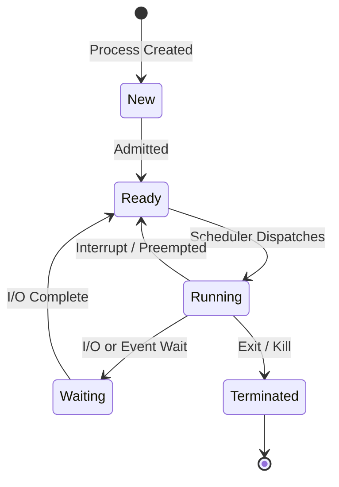

> 🔗 **References:**
> - Operating Systems: Three Easy Pieces (OSTEP, free) — https://pages.cs.wisc.edu/~remzi/OSTEP/
> - Linux Kernel Documentation — https://www.kernel.org/doc/html/latest/
> - OSDev Wiki (community) — https://wiki.osdev.org/

---

### 1.2 Linux Fundamentals

| # | Topic | Subtopics | Key Concepts |
|---|---|---|---|
| 1.2.1 | 🔧 Linux Distributions | Ubuntu/Debian, RHEL/CentOS/Alma, Alpine, Arch | Package managers: apt, yum/dnf, apk, pacman |
| 1.2.2 | 🔧 File System Hierarchy | `/`, `/etc`, `/var`, `/home`, `/opt`, `/tmp`, `/proc`, `/sys` | FHS standard, where configs/logs/binaries live |
| 1.2.3 | 🔧 Essential Commands — Navigation | `ls`, `cd`, `pwd`, `mkdir`, `rmdir`, `tree` | Absolute vs relative paths, hidden files (dotfiles) |
| 1.2.4 | 🔧 Essential Commands — File Operations | `cp`, `mv`, `rm`, `touch`, `ln`, `find`, `locate` | Hard links vs symlinks, recursive operations, globbing |
| 1.2.5 | 🔧 Essential Commands — Viewing/Editing | `cat`, `less`, `head`, `tail`, `wc`, `diff`, `vim`, `nano` | `tail -f` for live logs, vim basics (i, :wq, dd, /search) |
| 1.2.6 | 🔧 Text Processing | `grep`, `sed`, `awk`, `cut`, `sort`, `uniq`, `tr`, `xargs` | Regex with grep, field extraction with awk, stream editing with sed |
| 1.2.7 | 🔧 Permissions & Ownership | `chmod`, `chown`, `chgrp`, umask, SUID, SGID, Sticky bit | `rwxr-xr-x` notation, octal (755, 644), ACLs |
| 1.2.8 | 🔧 Users & Groups | `useradd`, `usermod`, `groupadd`, `passwd`, `/etc/passwd`, `/etc/shadow` | Root user, sudo, sudoers file, principle of least privilege |
| 1.2.9 | 🔧 Package Management | `apt update/install/remove`, `yum install`, `dpkg`, `rpm` | Repositories, GPG keys, pinning versions, dependency resolution |
| 1.2.10 | 🔧 Process Management | `ps`, `top`, `htop`, `kill`, `killall`, `nice`, `renice`, `nohup`, `&` | Foreground/background jobs, process priority, `jobs`, `fg`, `bg` |
| 1.2.11 | 🔧 Disk & Storage | `df`, `du`, `mount`, `umount`, `fdisk`, `lsblk`, `mkfs`, LVM | Partitions, logical volumes, PV→VG→LV, resize operations |
| 1.2.12 | 🔧 Archiving & Compression | `tar`, `gzip`, `bzip2`, `xz`, `zip`, `unzip` | `tar -czf`, `tar -xzf`, compression ratios |
| 1.2.13 | 🔧 SSH | `ssh`, `scp`, `rsync`, SSH keys, `ssh-keygen`, `ssh-agent`, `~/.ssh/config` | Key-based auth, port forwarding, tunnels, jump hosts |
| 1.2.14 | 🔧 Environment Variables | `export`, `env`, `printenv`, `.bashrc`, `.profile`, `/etc/environment` | PATH, HOME, USER, custom vars, variable expansion |

```mermaid
graph TD
    subgraph "Linux File System Hierarchy"
        ROOT["/  (root)"]
        BIN["/bin — Essential binaries"]
        ETC["/etc — Configuration files"]
        HOME["/home — User directories"]
        VAR["/var — Variable data (logs, spool)"]
        TMP["/tmp — Temporary files"]
        OPT["/opt — Optional software"]
        PROC["/proc — Virtual process info"]
        USR["/usr — User programs"]
        DEV["/dev — Device files"]
    end

    ROOT --> BIN
    ROOT --> ETC
    ROOT --> HOME
    ROOT --> VAR
    ROOT --> TMP
    ROOT --> OPT
    ROOT --> PROC
    ROOT --> USR
    ROOT --> DEV

    style ROOT fill:#c62828,stroke:#b71c1c,color:#ffffff
    style BIN fill:#1565c0,stroke:#0d47a1,color:#ffffff
    style ETC fill:#2e7d32,stroke:#1b5e20,color:#ffffff
    style HOME fill:#6a1b9a,stroke:#4a148c,color:#ffffff
    style VAR fill:#e65100,stroke:#bf360c,color:#ffffff
    style TMP fill:#00695c,stroke:#004d40,color:#ffffff
    style OPT fill:#283593,stroke:#1a237e,color:#ffffff
    style PROC fill:#ad1457,stroke:#880e4f,color:#ffffff
    style USR fill:#0277bd,stroke:#01579b,color:#ffffff
    style DEV fill:#37474f,stroke:#263238,color:#ffffff

> ⚡ **Interview Focus:** Explain what happens when you run `ls -la /tmp` — from shell parsing to syscall to output.

> 🔗 **References:**
> - ArchWiki — https://wiki.archlinux.org/ — (the gold-standard Linux wiki, used by all distros)
> - Linux man-pages project — https://man7.org/linux/man-pages/
> - The Linux Documentation Project — https://tldp.org/
> - Linux Journey — https://linuxjourney.com/

---

### 1.3 Shell & Bash Scripting

| # | Topic | Subtopics | Key Concepts |
|---|---|---|---|
| 1.3.1 | 🔧 Script Basics | Shebang (`#!/bin/bash`), `chmod +x`, execution | `set -e`, `set -o pipefail`, `set -u` for safe scripting |
| 1.3.2 | 🔧 Variables & Strings | Declaration, quoting (single vs double), string ops | `"$var"` vs `$var`, `${var:-default}`, `${#var}` |
| 1.3.3 | 🔧 Conditionals | `if/elif/else/fi`, `[[ ]]` tests, `case` | `-f` (file), `-d` (dir), `-z` (empty), `-n` (non-empty), string/number comparison |
| 1.3.4 | 🔧 Loops | `for`, `while`, `until`, `select` | Iterating over files, command output, ranges (`{1..10}`) |
| 1.3.5 | 🔧 Functions | Definition, arguments (`$1`, `$2`, `$@`), return values | Local variables, exit codes, function libraries (source) |
| 1.3.6 | 🔧 Input/Output | `read`, `echo`, `printf`, redirection (`>`, `>>`, `2>&1`) | Here documents (`<<EOF`), `/dev/null`, tee |
| 1.3.7 | 🔧 Pipes & Command Substitution | `|`, `$(command)`, `xargs`, process substitution | Chaining commands: `grep ... | sort | uniq -c | sort -rn | head` |
| 1.3.8 | 🔧 Exit Codes & Error Handling | `$?`, `trap`, `set -e` | Cleanup on exit, signal handling, logging |
| 1.3.9 | 🔧 Cron Jobs & Scheduling | `crontab -e`, cron syntax, `at`, systemd timers | `*/5 * * * *`, log rotation, backup scripts |
| 1.3.10 | 🔧 Practical Scripts | Deploy scripts, log parsers, health checkers, backup automation | Real-world patterns: lock files, PID files, argument parsing with `getopts` |

> 🔗 **References:**
> - Bash Reference Manual — https://www.gnu.org/software/bash/manual/
> - Shell Scripting Tutorial — https://www.shellscript.sh/
> - Advanced Bash-Scripting Guide — https://tldp.org/LDP/abs/html/

---

### 1.4 System Administration

| # | Topic | Subtopics | Key Concepts |
|---|---|---|---|
| 1.4.1 | 🔧 systemd | `systemctl start/stop/restart/enable/status`, unit files | Service management, `journalctl`, custom service creation |
| 1.4.2 | 🔧 Log Management | `/var/log/`, `journalctl`, syslog, logrotate | `dmesg`, `auth.log`, application logs, structured logging |
| 1.4.3 | 🔧 Performance Monitoring | `top`, `htop`, `vmstat`, `iostat`, `sar`, `strace`, `lsof` | CPU-bound vs I/O-bound, load average, memory pressure |
| 1.4.4 | 🔧 Networking Configuration | `ip addr`, `ip route`, `netplan`, `/etc/hosts`, `/etc/resolv.conf` | Static vs DHCP, interface management, routing tables |
| 1.4.5 | 🔧 Firewall Management | `ufw`, `iptables`, `firewalld`, `nftables` | Allow/deny rules, port-based filtering, NAT, zones |
| 1.4.6 | 🔧 Time & NTP | `timedatectl`, `chrony`, NTP | Time sync critical for logs, TLS, distributed systems |
| 1.4.7 | 🔧 Boot Process | BIOS/UEFI → Bootloader (GRUB) → Kernel → init/systemd | Boot troubleshooting, runlevels, rescue mode |
| 1.4.8 | 🔧 Virtualization Basics | KVM, QEMU, VirtualBox | Hypervisor types (Type 1 vs Type 2), VM vs container |

> 🔗 **References:**
> - systemd Documentation — https://systemd.io/
> - DigitalOcean Server Administration Tutorials — https://www.digitalocean.com/community/tags/linux-basics
> - Brendan Gregg's Linux Performance — https://www.brendangregg.com/linuxperf.html

---

## Phase 2 — Networking & Security Fundamentals

### 2.1 Networking Theory (OSI & TCP/IP)

| # | Topic | Subtopics | Key Concepts |
|---|---|---|---|
| 2.1.1 | 📖 OSI Model (7 Layers) | Physical, Data Link, Network, Transport, Session, Presentation, Application | Each layer's responsibility, encapsulation, PDUs at each layer |
| 2.1.2 | 📖 TCP/IP Model (4 Layers) | Network Access, Internet, Transport, Application | IP addressing (IPv4/IPv6), TCP vs UDP, port numbers |
| 2.1.3 | 📖 IP Addressing | IPv4 (32-bit), IPv6 (128-bit), subnetting, CIDR | `192.168.1.0/24`, subnet mask, private ranges (10.x, 172.16-31.x, 192.168.x) |
| 2.1.4 | 📖 TCP Deep Dive | 3-way handshake, flow control, congestion control, windowing | SYN → SYN-ACK → ACK, sequence numbers, retransmission |
| 2.1.5 | 📖 UDP | Connectionless, no ordering, low overhead | DNS queries, streaming, gaming, when to use UDP vs TCP |
| 2.1.6 | 📖 NAT & PAT | Network Address Translation, Port Address Translation | Private ↔ Public IP mapping, SNAT, DNAT |
| 2.1.7 | 📖 Routing | Static routing, Dynamic routing (OSPF, BGP), Default gateway | Routing table, hops, TTL, traceroute |

```mermaid
graph TB
    subgraph "OSI Model"
        L7[Layer 7: Application<br/>HTTP, SMTP, DNS, FTP]
        L6[Layer 6: Presentation<br/>SSL/TLS, Encryption, Compression]
        L5[Layer 5: Session<br/>Session management, Auth]
        L4[Layer 4: Transport<br/>TCP, UDP — Ports]
        L3[Layer 3: Network<br/>IP, ICMP — Routing]
        L2[Layer 2: Data Link<br/>Ethernet, MAC, Switch]
        L1[Layer 1: Physical<br/>Cables, Signals, Hubs]
    end

    L7 --> L6 --> L5 --> L4 --> L3 --> L2 --> L1

    style L7 fill:#1565c0,stroke:#0d47a1,color:#ffffff
    style L6 fill:#283593,stroke:#1a237e,color:#ffffff
    style L5 fill:#4527a0,stroke:#311b92,color:#ffffff
    style L4 fill:#6a1b9a,stroke:#4a148c,color:#ffffff
    style L3 fill:#ad1457,stroke:#880e4f,color:#ffffff
    style L2 fill:#c62828,stroke:#b71c1c,color:#ffffff
    style L1 fill:#37474f,stroke:#263238,color:#ffffff
```

> 🔗 **References:**
> - Computer Networking: A Top-Down Approach (Kurose & Ross) — Textbook (the standard university networking book)
> - Cloudflare Learning Center — Networking — https://www.cloudflare.com/learning/network-layer/what-is-the-network-layer/
> - Practical Networking — https://www.practicalnetworking.net/
> - Ben Eater: Networking Tutorial (visual) — https://www.youtube.com/playlist?list=PLowKtXNTBypGqImE405J2565dvjafglHU

---

### 2.2 Protocols & Services

| # | Topic | Subtopics | Key Concepts |
|---|---|---|---|
| 2.2.1 | 📖 DNS | A, AAAA, CNAME, MX, TXT, NS, SOA records | Domain resolution flow, TTL, recursive vs iterative, DNS caching |
| 2.2.2 | 📖 HTTP/HTTPS | Methods (GET/POST/PUT/DELETE), Status codes (2xx/3xx/4xx/5xx), Headers | Request/response lifecycle, cookies, sessions, content negotiation |
| 2.2.3 | 📖 SSH | Key exchange, authentication, tunneling | Port 22, SSH keys (RSA/Ed25519), agent forwarding, config file |
| 2.2.4 | 📖 DHCP | IP lease, DORA process | Discover → Offer → Request → Acknowledge |
| 2.2.5 | 📖 FTP/SFTP/SCP | File transfer protocols | Active vs Passive FTP, SFTP over SSH, `rsync` vs `scp` |
| 2.2.6 | 📖 SMTP/IMAP/POP3 | Email protocols | SPF, DKIM, DMARC — email authentication |
| 2.2.7 | 📖 NTP | Network Time Protocol | Stratum levels, clock synchronization |
| 2.2.8 | ⚡ Common Port Numbers | 22 (SSH), 25 (SMTP), 53 (DNS), 80 (HTTP), 443 (HTTPS), 3306 (MySQL), 5432 (PostgreSQL), 6379 (Redis), 8080 (Alt HTTP) | Port ranges: well-known (0-1023), registered (1024-49151), dynamic (49152-65535) |

> 🔗 **References:**
> - MDN Web Docs — HTTP — https://developer.mozilla.org/en-US/docs/Web/HTTP (Mozilla official, world-class)
> - Cloudflare — What is DNS? — https://www.cloudflare.com/learning/dns/what-is-dns/
> - IANA Service Name and Port Number Registry — https://www.iana.org/assignments/service-names-port-numbers/
> - RFC Editor — https://www.rfc-editor.org/ (official Internet standards)

---

### 2.3 Network Troubleshooting Tools

| # | Tool | Purpose | Key Usage |
|---|---|---|---|
| 2.3.1 | 🔧 `ping` | Test connectivity (ICMP) | `ping -c 4 google.com`, latency, packet loss |
| 2.3.2 | 🔧 `traceroute` / `tracepath` | Show route to destination | Hop-by-hop analysis, identify bottlenecks |
| 2.3.3 | 🔧 `curl` / `wget` | HTTP requests from CLI | `curl -sI` (headers), `curl -X POST -d`, `wget` for downloads |
| 2.3.4 | 🔧 `dig` / `nslookup` | DNS lookup | `dig +short example.com`, record types, DNS server testing |
| 2.3.5 | 🔧 `netstat` / `ss` | Socket statistics | `ss -tlnp` (listening TCP), `ss -s` (summary) |
| 2.3.6 | 🔧 `tcpdump` | Packet capture | `tcpdump -i eth0 port 80`, packet analysis |
| 2.3.7 | 🔧 `nmap` | Port scanning | `nmap -sT localhost`, service detection, security auditing |
| 2.3.8 | 🔧 `ip` command | Network interface management | `ip addr`, `ip route`, `ip link` — replacement for ifconfig |
| 2.3.9 | 🔧 `mtr` | Combined ping + traceroute | Real-time network path analysis |

> 🔗 **References:**
> - Julia Evans Networking Zines — https://jvns.ca/categories/networking/
> - Nmap Network Scanning (book, free online) — https://nmap.org/book/
> - tcpdump Tutorial — https://danielmiessler.com/p/tcpdump/

---

### 2.4 Firewalls, Proxies & Load Balancers

| # | Topic | Subtopics | Key Concepts |
|---|---|---|---|
| 2.4.1 | 📖 Firewall Concepts | Stateful vs Stateless, Packet filtering, Application-layer filtering | Ingress / Egress rules, default deny, whitelist vs blacklist |
| 2.4.2 | 📖 Forward Proxy | Client-side proxy, content filtering, caching | Squid, corporate proxies, anonymization |
| 2.4.3 | 📖 Reverse Proxy | Server-side proxy, request routing, TLS termination | Nginx, HAProxy, Traefik — sits in front of backend servers |
| 2.4.4 | 📖 Load Balancing | Round Robin, Least Connections, IP Hash, Weighted | L4 (transport) vs L7 (application) load balancing |
| 2.4.5 | 📖 CDN | Content Delivery Network, edge servers, caching | Cloudflare, CloudFront, Akamai — reduce latency globally |

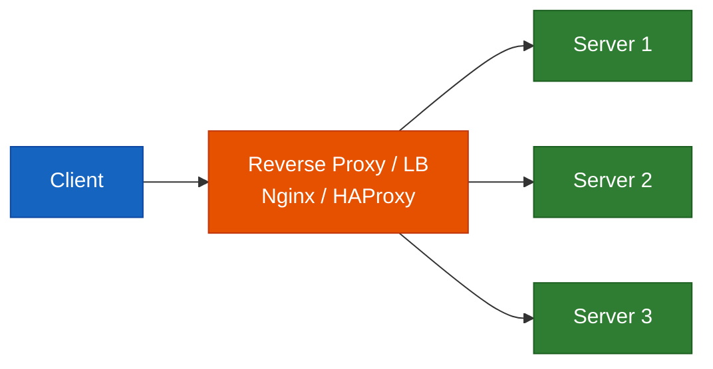

> 🔗 **References:**
> - DigitalOcean Load Balancing Concepts — https://www.digitalocean.com/community/tutorials/what-is-load-balancing
> - HAProxy Documentation — https://www.haproxy.org/#docs
> - Cloudflare Learning Center — https://www.cloudflare.com/learning/

---

### 2.5 SSL/TLS & Cryptography Basics

| # | Topic | Subtopics | Key Concepts |
|---|---|---|---|
| 2.5.1 | 📖 Symmetric vs Asymmetric Encryption | AES (symmetric), RSA/ECDSA (asymmetric) | Symmetric = same key; Asymmetric = public + private key pair |
| 2.5.2 | 📖 Hash Functions | SHA-256, MD5 (deprecated), bcrypt | Integrity verification, password hashing, digital signatures |
| 2.5.3 | 📖 TLS Handshake | Client Hello → Server Hello → Certificate → Key Exchange → Finished | Certificate chain, CA (Certificate Authority), certificate pinning |
| 2.5.4 | 🔧 Certificate Management | Let's Encrypt, Certbot, self-signed certificates | CSR generation, renewal automation, wildcard certificates |
| 2.5.5 | 🔧 OpenSSL | `openssl req`, `openssl x509`, `openssl s_client` | Generate keys, create certificates, verify SSL connections |

> 🔗 **References:**
> - How HTTPS Works — https://howhttps.works/
> - How DNS Works — https://howdns.works/
> - Professor Messer's Network+ — https://www.professormesser.com/

---

## Phase 3 — Version Control (Git)

### 3.1 Git Fundamentals

| # | Topic | Subtopics | Key Concepts |
|---|---|---|---|
| 3.1.1 | 📖 What is Version Control | History, types (centralized vs distributed) | SVN (centralized) vs Git (distributed), why Git won |
| 3.1.2 | 📖 Git Architecture | Working directory, Staging area, Repository (.git) | Three trees model, HEAD, commits as snapshots |
| 3.1.3 | 🔧 Basic Commands | `git init`, `clone`, `add`, `commit`, `status`, `log`, `diff` | Staging workflow, commit messages (conventional commits) |
| 3.1.4 | 🔧 Undoing Changes | `git reset`, `revert`, `checkout`, `restore`, `stash` | Soft/Mixed/Hard reset, when to revert vs reset |
| 3.1.5 | 🔧 Remote Operations | `git remote`, `push`, `pull`, `fetch` | Origin, upstream, tracking branches |
| 3.1.6 | 🔧 Tags | `git tag`, lightweight vs annotated | Semantic versioning, release tags |
| 3.1.7 | 🔧 .gitignore | Patterns, global gitignore | Ignore build artifacts, dependencies, secrets, OS files |

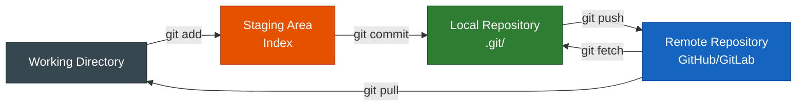

---

### 3.2 Branching Strategies

| # | Topic | Subtopics | Key Concepts |
|---|---|---|---|
| 3.2.1 | 🔧 Branch Operations | `git branch`, `checkout -b`, `switch`, `merge`, `rebase` | Fast-forward vs 3-way merge, merge commit |
| 3.2.2 | 📐 Git Flow | `main`, `develop`, `feature/*`, `release/*`, `hotfix/*` | Long-lived branches, versioned releases |
| 3.2.3 | 📐 Trunk-Based Development | Single main branch, short-lived feature branches | Feature flags, continuous integration friendly |
| 3.2.4 | 📐 GitHub Flow | Main + feature branches + PRs | Simple, CI/CD friendly, deploy-on-merge |
| 3.2.5 | 🔧 Merge Conflicts | Detection, resolution, tools | `git mergetool`, manual resolution, prevention strategies |
| 3.2.6 | 🔧 Rebase vs Merge | Interactive rebase, squash, fixup | Clean history (rebase) vs preserved history (merge) |
| 3.2.7 | 🔧 Cherry-Pick | `git cherry-pick <commit>` | Hotfix backporting, selective commit application |

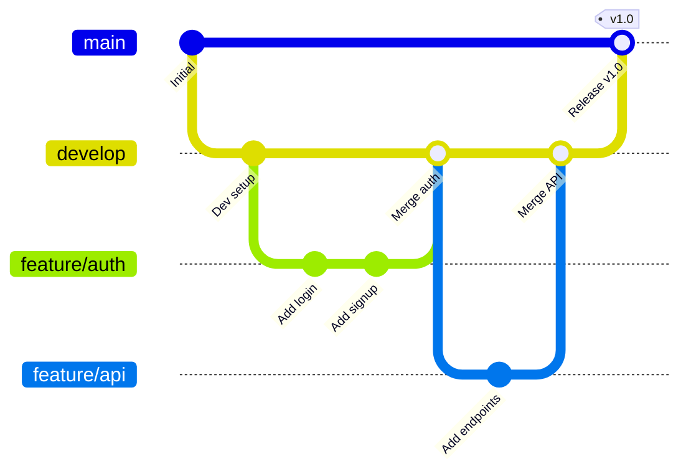

---

### 3.3 Collaboration & Code Review

| # | Topic | Subtopics | Key Concepts |
|---|---|---|---|
| 3.3.1 | 🔧 Pull Requests / Merge Requests | Creating, reviewing, approving, merging | PR templates, review checklists, approval rules |
| 3.3.2 | 📖 Code Review Best Practices | Scope, feedback, iterative reviews | Constructive feedback, LGTM, requesting changes |
| 3.3.3 | 🔧 Git Hooks | pre-commit, pre-push, commit-msg | Linting, formatting, preventing secrets in commits |
| 3.3.4 | 🔧 Conventional Commits | `feat:`, `fix:`, `docs:`, `chore:`, `refactor:` | Automated changelogs, semantic versioning integration |

---

### 3.4 Git Hosting Platforms

| # | Platform | Key Features | DevOps Relevance |
|---|---|---|---|
| 3.4.1 | 🔧 GitHub | Actions (CI/CD), Packages, Projects, Codespaces | Most popular, massive ecosystem |
| 3.4.2 | 🔧 GitLab | Built-in CI/CD, Container Registry, Wiki, Boards | All-in-one DevOps platform |
| 3.4.3 | 🔧 Bitbucket | Jira integration, Pipelines | Atlassian ecosystem |

> 🔗 **References:**
> - Pro Git Book (free) — https://git-scm.com/book/en/v2
> - Learn Git Branching (interactive) — https://learngitbranching.js.org/
> - Git Command Explorer — https://gitexplorer.com/

---

## Phase 4 — Containers & Docker

### 4.1 Containerization Concepts

| # | Topic | Subtopics | Key Concepts |
|---|---|---|---|
| 4.1.1 | 📖 What is Containerization | OS-level virtualization, Linux namespaces, cgroups | Isolation without hypervisor, shared kernel |
| 4.1.2 | 📖 Containers vs VMs | Architecture comparison, resource usage, boot time | Containers: lightweight, seconds to start; VMs: full OS, minutes to start |
| 4.1.3 | 📖 OCI Standards | Open Container Initiative, Image Spec, Runtime Spec | Portability, interoperability between runtimes |
| 4.1.4 | 📖 Container Runtimes | containerd, CRI-O, runc | Docker uses containerd → runc under the hood |

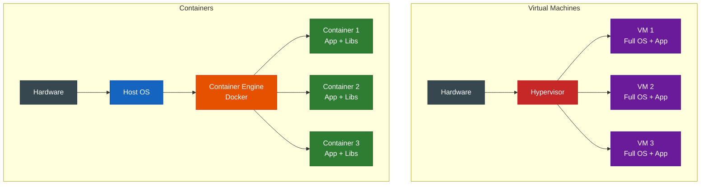

---

### 4.2 Docker Fundamentals

| # | Topic | Subtopics | Key Concepts |
|---|---|---|---|
| 4.2.1 | 🔧 Installation | Docker Engine, Docker Desktop, Docker CLI | `docker version`, `docker info`, daemon vs CLI |
| 4.2.2 | 🔧 Images | `docker pull`, `docker images`, `docker rmi`, layers | Base images, image layers, image IDs, tags |
| 4.2.3 | 🔧 Containers | `docker run`, `docker ps`, `docker stop`, `docker rm` | `-d` (detach), `-it` (interactive), `--name`, `--rm` |
| 4.2.4 | 🔧 Exec & Logs | `docker exec -it <id> bash`, `docker logs -f` | Debugging running containers, following logs |
| 4.2.5 | 🔧 Inspect & Stats | `docker inspect`, `docker stats`, `docker top` | Resource usage, container configuration, metadata |

---

### 4.3 Dockerfile Mastery

| # | Topic | Subtopics | Key Concepts |
|---|---|---|---|
| 4.3.1 | 🔧 Dockerfile Instructions | `FROM`, `RUN`, `COPY`, `ADD`, `WORKDIR`, `ENV`, `ARG` | Instruction ordering, layer caching |
| 4.3.2 | 🔧 Entrypoint & CMD | `CMD`, `ENTRYPOINT`, `SHELL` form vs `EXEC` form | `CMD` = default args, `ENTRYPOINT` = main process |
| 4.3.3 | 🔧 EXPOSE & Ports | `EXPOSE`, `-p host:container` | Documentation vs actual port mapping |
| 4.3.4 | 🔧 Health Checks | `HEALTHCHECK --interval --timeout CMD curl...` | Container orchestration relies on health status |
| 4.3.5 | 📐 Multi-Stage Builds | Build stage + Production stage | Reduce final image size, separate build deps from runtime |
| 4.3.6 | 📐 Best Practices | Order instructions (least → most changing), minimize layers | Combine RUN commands, use .dockerignore, don't run as root |
| 4.3.7 | 🔧 .dockerignore | Exclude files from build context | `.git`, `node_modules`, `__pycache__`, `*.md`, `*.log` |

> ⚡ **Interview Focus:** Why does instruction order matter in a Dockerfile? Explain layer caching and cache invalidation.

---

### 4.4 Docker Compose

| # | Topic | Subtopics | Key Concepts |
|---|---|---|---|
| 4.4.1 | 🔧 Compose Basics | `docker-compose.yml` structure, `version`, `services` | `docker compose up -d`, `down`, `logs`, `ps` |
| 4.4.2 | 🔧 Service Definition | `build`, `image`, `ports`, `environment`, `volumes` | Build context, environment from file (`.env`) |
| 4.4.3 | 🔧 Dependencies | `depends_on`, health checks, startup order | Service readiness vs container start |
| 4.4.4 | 🔧 Networking | Default network, custom networks, `network_mode` | Service discovery by container name, network isolation |
| 4.4.5 | 🔧 Volumes | Named volumes, bind mounts, `driver_opts` | Persist data across container restarts |
| 4.4.6 | 🔧 Scaling | `docker compose up --scale web=3` | Horizontal scaling, port range mapping |
| 4.4.7 | 🔧 Profiles & Overrides | `docker-compose.override.yml`, profiles | Dev vs Prod configurations |

---

### 4.5 Docker Networking & Volumes

| # | Topic | Subtopics | Key Concepts |
|---|---|---|---|
| 4.5.1 | 📖 Network Drivers | bridge, host, none, overlay, macvlan | Default bridge, user-defined bridge (DNS resolution) |
| 4.5.2 | 📖 DNS in Docker | Container name resolution, `--link` (deprecated), network aliases | Embed service discovery in user-defined networks |
| 4.5.3 | 📖 Volume Types | Named volumes, Bind mounts, tmpfs | Named = Docker manages; Bind = host path; tmpfs = in-memory |
| 4.5.4 | 🔧 Volume Backup & Migration | `docker run --volumes-from`, tar-based backup | Data portability across hosts |

---

### 4.6 Container Registries

| # | Topic | Subtopics | Key Concepts |
|---|---|---|---|
| 4.6.1 | 🔧 Docker Hub | `docker login`, `push`, `pull`, public/private repos | Rate limits, official images, automated builds |
| 4.6.2 | 🔧 Private Registries | Harbor, AWS ECR, Azure ACR, GCR, GHCR | Self-hosted, authentication, vulnerability scanning |
| 4.6.3 | 📖 Image Tagging Strategy | `latest`, semantic versioning, git SHA | `app:v1.2.3`, `app:main-abc1234`, immutable tags |

---

### 4.7 Container Security

| # | Topic | Subtopics | Key Concepts |
|---|---|---|---|
| 4.7.1 | 📐 Run as Non-Root | `USER` instruction, `--user` flag | Principle of least privilege in containers |
| 4.7.2 | 📐 Read-Only Filesystem | `--read-only`, tmpfs for writeable dirs | Prevent runtime modifications |
| 4.7.3 | 🔧 Image Scanning | Trivy, Snyk, Docker Scout | CVE detection, scan in CI pipeline |
| 4.7.4 | 📐 Minimal Base Images | alpine, distroless, scratch | Smaller attack surface, fewer vulnerabilities |

> 🔗 **References:**
> - Docker Documentation (official) — https://docs.docker.com/
> - Docker Getting Started Guide — https://docs.docker.com/get-started/
> - Play with Docker (free browser labs) — https://labs.play-with-docker.com/
> - Container Security — Liz Rice (O'Reilly Book)

---

## Phase 5 — Web Servers & Server Management

### 5.1 Web Server Fundamentals

| # | Topic | Subtopics | Key Concepts |
|---|---|---|---|
| 5.1.1 | 📖 What Web Servers Do | Accept HTTP requests, serve responses | Static file serving, dynamic content proxying |
| 5.1.2 | 📖 Popular Web Servers | Nginx, Apache, Caddy, IIS, Tomcat | Nginx: event-driven; Apache: process/thread-based |
| 5.1.3 | 📖 Process Models | Event-driven vs Fork/Thread | Concurrency handling, C10K problem |

---

### 5.2 Nginx Deep Dive

| # | Topic | Subtopics | Key Concepts |
|---|---|---|---|
| 5.2.1 | 🔧 Installation & Config | `nginx.conf`, `sites-available`, `sites-enabled` | `server` blocks, `location` blocks, `listen`, `server_name` |
| 5.2.2 | 🔧 Static File Serving | `root`, `index`, `try_files` | SPA fallback: `try_files $uri $uri/ /index.html` |
| 5.2.3 | 🔧 Reverse Proxy | `proxy_pass`, `proxy_set_header` | Backend proxying, WebSocket proxying, header forwarding |
| 5.2.4 | 🔧 SSL/TLS Configuration | `ssl_certificate`, `ssl_certificate_key`, HSTS | Let's Encrypt + Certbot automation |
| 5.2.5 | 🔧 Rate Limiting | `limit_req_zone`, `limit_conn_zone` | DDoS protection, API rate limiting |
| 5.2.6 | 🔧 Gzip Compression | `gzip on`, `gzip_types`, `gzip_min_length` | Reduce response size 60-80% |
| 5.2.7 | 🔧 Access & Error Logs | `access_log`, `error_log`, custom log formats | Log analysis, debugging, monitoring integration |

---

### 5.3 Reverse Proxy & Load Balancing

| # | Topic | Subtopics | Key Concepts |
|---|---|---|---|
| 5.3.1 | 📐 Load Balancing Algorithms | Round Robin, Least Connections, IP Hash, Weighted | Choose based on: stateless (RR), stateful (IP Hash), varied capacity (Weighted) |
| 5.3.2 | 📐 Health Checks | Active checks, passive checks, circuit breaker | Upstream health, fail_timeout, max_fails |
| 5.3.3 | 📐 Sticky Sessions | Cookie-based, IP-based | Session persistence for stateful apps |
| 5.3.4 | 📐 Blue-Green / Canary | Traffic splitting, gradual rollout | Zero-downtime deployments |

---

### 5.4 Caching Strategies

| # | Topic | Subtopics | Key Concepts |
|---|---|---|---|
| 5.4.1 | 📖 Cache Levels | Browser, CDN, Reverse Proxy, Application, Database | Cache hierarchy, TTL, cache invalidation |
| 5.4.2 | 📖 HTTP Cache Headers | `Cache-Control`, `ETag`, `Last-Modified`, `Expires` | `max-age`, `no-cache`, `no-store`, `must-revalidate` |
| 5.4.3 | 🔧 Redis as Cache | In-memory store, TTL, eviction policies | `SET`, `GET`, `EXPIRE`, LRU eviction |
| 5.4.4 | ⚡ Cache Invalidation | "Two hard problems in CS" | TTL-based, event-based, key-based (versioned URLs) |

> 🔗 **References:**
> - Nginx Documentation (official) — https://nginx.org/en/docs/
> - Nginx Beginner's Guide (official) — https://nginx.org/en/docs/beginners_guide.html
> - Caddy Documentation — https://caddyserver.com/docs/ (modern alternative, auto-HTTPS)
> - Apache HTTP Server Docs (official) — https://httpd.apache.org/docs/

---

## Phase 6 — CI/CD Pipelines

### 6.1 CI/CD Concepts

| # | Topic | Subtopics | Key Concepts |
|---|---|---|---|
| 6.1.1 | 📖 Continuous Integration (CI) | Frequent merging, automated builds, automated tests | Merge to main often, catch bugs early, build every commit |
| 6.1.2 | 📖 Continuous Delivery (CD) | Automated deployment to staging, manual approval for prod | Always in a deployable state |
| 6.1.3 | 📖 Continuous Deployment | Automated deployment all the way to production | Every passing commit goes to prod — requires high test confidence |
| 6.1.4 | 📖 Pipeline Stages | Source → Build → Test → Package → Deploy → Monitor | Each stage is a gate; failure stops the pipeline |

```mermaid
graph LR
    A[Code Push] --> B[Build]
    B --> C[Unit Tests]
    C --> D[Integration Tests]
    D --> E[Security Scan]
    E --> F[Build Docker Image]
    F --> G[Push to Registry]
    G --> H[Deploy to Staging]
    H --> I{Manual Approval}
    I -->|Approved| J[Deploy to Production]
    I -->|Rejected| K[Rollback]

    style A fill:#2e7d32,stroke:#1b5e20,color:#ffffff
    style B fill:#1565c0,stroke:#0d47a1,color:#ffffff
    style C fill:#0277bd,stroke:#01579b,color:#ffffff
    style D fill:#00695c,stroke:#004d40,color:#ffffff
    style E fill:#6a1b9a,stroke:#4a148c,color:#ffffff
    style F fill:#4527a0,stroke:#311b92,color:#ffffff
    style G fill:#283593,stroke:#1a237e,color:#ffffff
    style H fill:#e65100,stroke:#bf360c,color:#ffffff
    style I fill:#ef6c00,stroke:#e65100,color:#ffffff
    style J fill:#2e7d32,stroke:#1b5e20,color:#ffffff
    style K fill:#c62828,stroke:#b71c1c,color:#ffffff
```

---

### 6.2 Pipeline Design

| # | Topic | Subtopics | Key Concepts |
|---|---|---|---|
| 6.2.1 | 📐 Pipeline as Code | YAML-based pipelines, version controlled | `.github/workflows/`, `.gitlab-ci.yml`, `Jenkinsfile` |
| 6.2.2 | 📐 Triggers | Push, PR, tag, schedule, manual | Branch filters, path filters, conditional execution |
| 6.2.3 | 📐 Environments | Development, Staging, Production | Environment-specific configs, secrets, approvals |
| 6.2.4 | 📐 Parallelism | Parallel jobs, matrix builds | Test across multiple OS/versions simultaneously |
| 6.2.5 | 📐 Caching | Dependency caching, layer caching | Speed up builds: cache `node_modules/`, `.pip-cache/` |
| 6.2.6 | 📐 Secrets Management in CI | Encrypted secrets, vault integration | NEVER hardcode secrets; use masked variables |
| 6.2.7 | 📐 Deployment Strategies | Rolling, Blue-Green, Canary, Recreate | Tradeoffs: speed vs safety vs complexity |

---

### 6.3 CI/CD Tools

| # | Tool | Key Features | Config File |
|---|---|---|---|
| 6.3.1 | 🔧 GitHub Actions | Marketplace actions, matrix builds, OIDC | `.github/workflows/*.yml` |
| 6.3.2 | 🔧 GitLab CI | Built-in, Auto DevOps, environments | `.gitlab-ci.yml` |
| 6.3.3 | 🔧 Jenkins | Plugins ecosystem, Groovy DSL, declarative pipeline | `Jenkinsfile` |
| 6.3.4 | 🔧 CircleCI | Orbs (reusable configs), docker-based | `.circleci/config.yml` |
| 6.3.5 | 🔧 Azure DevOps Pipelines | YAML + Classic editor, Azure integration | `azure-pipelines.yml` |
| 6.3.6 | 🔧 Tekton | Cloud-native CI/CD on Kubernetes | Tasks, Pipelines, Triggers — CNCF project, K8s-native resources |
| 6.3.7 | 🔧 Drone CI | Container-native, YAML pipelines | Lightweight, Docker-first CI/CD |

---

### 6.4 Artifact Management

| # | Topic | Subtopics | Key Concepts |
|---|---|---|---|
| 6.4.1 | 📖 What are Artifacts | Build outputs, packages, images | Versioned, immutable, stored centrally |
| 6.4.2 | 🔧 Container Images | Docker Hub, ECR, ACR, GHCR | Tag strategy, vulnerability scanning, promotion |
| 6.4.3 | 🔧 Package Registries | npm, PyPI, Maven, NuGet | Private package hosting, dependency management |
| 6.4.4 | 🔧 Artifact Repositories | JFrog Artifactory, Nexus | Universal artifact management |

---

### 6.5 Testing in Pipelines

| # | Topic | Subtopics | Key Concepts |
|---|---|---|---|
| 6.5.1 | 📖 Test Pyramid | Unit → Integration → E2E | More unit tests (fast/cheap) → fewer E2E tests (slow/expensive) |
| 6.5.2 | 🔧 Unit Testing | pytest, Jest, JUnit, Go test | Test individual functions/methods in isolation |
| 6.5.3 | 🔧 Integration Testing | API tests, database tests, contract tests | Test component interactions |
| 6.5.4 | 🔧 E2E / Smoke Testing | Selenium, Playwright, Cypress, curl-based | Verify critical user flows post-deployment |
| 6.5.5 | 🔧 Code Quality & Linting | SonarQube, ESLint, flake8, golangci-lint | Quality gates, code coverage thresholds |
| 6.5.6 | 🔧 SAST & DAST | Static/Dynamic Application Security Testing | Trivy, Snyk, OWASP ZAP — shift-left security |

---

### 6.6 Progressive Delivery & Feature Flags

| # | Topic | Subtopics | Key Concepts |
|---|---|---|---|
| 6.6.1 | 📐 Progressive Delivery | Gradual rollout with automated analysis | Extend CI/CD with progressive traffic shifting + metrics-based promotion |
| 6.6.2 | 🔧 Argo Rollouts | Canary, Blue-Green deployments for K8s | `AnalysisRun` (automatic rollback), traffic weight steps, Prometheus metrics gate |
| 6.6.3 | 🔧 Flagger | Automated canary with service mesh integration | Works with Istio, Linkerd, App Mesh; metric-based analysis + automatic promotion/rollback |
| 6.6.4 | 📐 Feature Flags | Decouple deployment from release | LaunchDarkly, Unleash, Flagsmith; trunk-based development enabler |
| 6.6.5 | 📐 Dark Launches | Deploy without exposing to users | Feature behind flag, test in production with internal traffic |
| 6.6.6 | 📐 A/B Testing | Experiment-driven releases | Metrics comparison, statistical significance, user segmentation |

> ⚡ **Interview Focus:** Explain the difference between _deployment_ and _release_. How do feature flags enable trunk-based development?

> 🔗 **References:**
> - GitHub Actions Documentation (official) — https://docs.github.com/en/actions
> - GitLab CI/CD Documentation (official) — https://docs.gitlab.com/ee/ci/
> - Jenkins Documentation (official) — https://www.jenkins.io/doc/
> - Continuous Delivery — Jez Humble & David Farley (Book, the definitive CI/CD reference)

---

## Phase 7 — Cloud Computing

### 7.1 Cloud Fundamentals

| # | Topic | Subtopics | Key Concepts |
|---|---|---|---|
| 7.1.1 | 📖 Cloud Service Models | IaaS, PaaS, SaaS, FaaS (Serverless) | IaaS: you manage OS up; PaaS: you manage app; SaaS: fully managed |
| 7.1.2 | 📖 Deployment Models | Public, Private, Hybrid, Multi-Cloud | Cost vs control tradeoffs |
| 7.1.3 | 📖 Regions & Availability Zones | Geographic regions, fault domains | High availability, disaster recovery, data residency |
| 7.1.4 | 📖 Shared Responsibility Model | Provider secures infrastructure; You secure your data/config | Critical for security decisions |
| 7.1.5 | 📖 Pricing Models | On-demand, Reserved, Spot/Preemptible, Free tier | Cost optimization strategies |

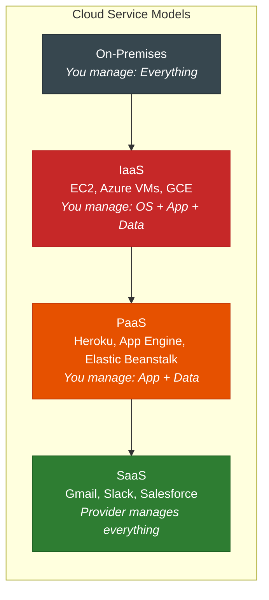

---

### 7.2 AWS Core Services

| # | Category | Service | Purpose |
|---|---|---|---|
| 7.2.1 | Compute | EC2 | Virtual servers (instances) — types, AMIs, security groups |
| 7.2.2 | Compute | Lambda | Serverless functions — event-driven, pay-per-invocation |
| 7.2.3 | Storage | S3 | Object storage — buckets, policies, lifecycle, versioning |
| 7.2.4 | Storage | EBS | Block storage for EC2 — volumes, snapshots, types (gp3, io2) |
| 7.2.5 | Database | RDS | Managed relational DB — PostgreSQL, MySQL, Multi-AZ, read replicas |
| 7.2.6 | Database | DynamoDB | NoSQL — key-value, serverless, single-digit ms latency |
| 7.2.7 | Networking | VPC | Virtual network — subnets, route tables, IGW, NAT Gateway |
| 7.2.8 | Networking | Route 53 | DNS service — hosted zones, health checks, routing policies |
| 7.2.9 | Networking | ALB/NLB | Load balancers — L7 (ALB) vs L4 (NLB) |
| 7.2.10 | Security | IAM | Users, Groups, Roles, Policies — principle of least privilege |
| 7.2.11 | Containers | ECR | Container registry |
| 7.2.12 | Containers | ECS / EKS | Container orchestration (proprietary / managed Kubernetes) |
| 7.2.13 | Monitoring | CloudWatch | Metrics, Logs, Alarms, Dashboards |
| 7.2.14 | Secrets | Secrets Manager / SSM | Store and rotate secrets / configuration parameters |
| 7.2.15 | Messaging | SQS / SNS | Message queue (decouple services) / Pub-sub notifications |
| 7.2.16 | CDN | CloudFront | Content delivery network — edge caching, HTTPS, signed URLs |
| 7.2.17 | API | API Gateway | REST/WebSocket APIs, throttling, auth, usage plans |
| 7.2.18 | Storage | EFS | Managed NFS — shared filesystem for EC2/ECS/Lambda |
| 7.2.19 | Cache | ElastiCache | Managed Redis / Memcached — session store, caching layer |
| 7.2.20 | Orchestration | Step Functions | Serverless workflow — state machines, task coordination |
| 7.2.21 | CI/CD | CodePipeline / CodeBuild / CodeDeploy | AWS-native CI/CD — source → build → deploy |
| 7.2.22 | Serverless | Fargate | Serverless container execution — no EC2 management |
| 7.2.23 | Analytics | Kinesis | Real-time streaming data — ingestion, processing, analytics |
| 7.2.24 | Analytics | Redshift | Data warehouse — columnar storage, petabyte-scale analytics |
| 7.2.25 | Governance | AWS Organizations / Control Tower | Multi-account strategy, SCPs, landing zone |
| 7.2.26 | Networking | Transit Gateway | Hub-and-spoke VPC connectivity, cross-region peering |
| 7.2.27 | Security | GuardDuty / Inspector / Security Hub | Threat detection, vulnerability assessment, unified security view |

---

### 7.3 Azure Core Services

| # | Category | Service | AWS Equivalent |
|---|---|---|---|
| 7.3.1 | Compute | Azure VMs | EC2 |
| 7.3.2 | Compute | Azure Functions | Lambda |
| 7.3.3 | Storage | Blob Storage | S3 |
| 7.3.4 | Database | Azure SQL / Cosmos DB | RDS / DynamoDB |
| 7.3.5 | Networking | VNet | VPC |
| 7.3.6 | Containers | AKS / ACR | EKS / ECR |
| 7.3.7 | CI/CD | Azure DevOps | — (native CI/CD platform) |
| 7.3.8 | Monitoring | Azure Monitor | CloudWatch |
| 7.3.9 | Security | Azure AD / Key Vault | IAM / Secrets Manager |
| 7.3.10 | Networking | Application Gateway / Front Door | ALB / CloudFront — L7 LB, WAF, CDN |
| 7.3.11 | Messaging | Service Bus / Event Grid | SQS-SNS / EventBridge — enterprise messaging, event-driven |
| 7.3.12 | Governance | Azure Policy / Blueprints | AWS Config / Control Tower — compliance, guardrails |
| 7.3.13 | Serverless | Azure Container Apps | Fargate — serverless containers with scale-to-zero |

---

### 7.4 GCP Core Services

| # | Category | Service | AWS Equivalent |
|---|---|---|---|
| 7.4.1 | Compute | Compute Engine | EC2 |
| 7.4.2 | Compute | Cloud Functions / Cloud Run | Lambda / Fargate |
| 7.4.3 | Storage | Cloud Storage | S3 |
| 7.4.4 | Database | Cloud SQL / Firestore / BigQuery | RDS / DynamoDB / Redshift |
| 7.4.5 | Networking | VPC | VPC |
| 7.4.6 | Containers | GKE / Artifact Registry | EKS / ECR |
| 7.4.7 | Monitoring | Cloud Operations (Stackdriver) | CloudWatch |
| 7.4.8 | CI/CD | Cloud Build / Cloud Deploy | CodeBuild / CodeDeploy |
| 7.4.9 | Serverless | Cloud Run | Fargate — fully managed containers, scale-to-zero |
| 7.4.10 | Messaging | Pub/Sub | SNS + SQS — global message bus, push/pull |
| 7.4.11 | Analytics | BigQuery | Redshift — serverless data warehouse, petabyte-scale |
| 7.4.12 | Orchestration | GKE Autopilot | Fully managed K8s — Google manages nodes |
| 7.4.13 | Security | Cloud IAM / Secret Manager | IAM / Secrets Manager |

---

### 7.5 Multi-Cloud & Cloud-Agnostic Patterns

| # | Topic | Subtopics | Key Concepts |
|---|---|---|---|
| 7.5.1 | 📐 Cloud-Agnostic IaC | Terraform, Pulumi | Write once, deploy to any cloud |
| 7.5.2 | 📐 Kubernetes as Abstraction | Same K8s manifests on any platform | EKS, AKS, GKE — portable workloads |
| 7.5.3 | 📐 Multi-Cloud Strategy | When and why to use multiple clouds | Avoid vendor lock-in, best-of-breed services, compliance |
| 7.5.4 | 📐 Crossplane | Provision cloud infrastructure from Kubernetes | CRDs for AWS/Azure/GCP resources; GitOps-friendly; control plane inside K8s |
| 7.5.5 | 📐 VPC Advanced Networking | Peering, Transit Gateway, PrivateLink, Direct Connect | Hub-and-spoke topology, hybrid connectivity, service endpoints |

> 🔗 **References:**
> - AWS Well-Architected Framework — https://aws.amazon.com/architecture/well-architected/
> - Azure Fundamentals (AZ-900) — https://learn.microsoft.com/en-us/certifications/azure-fundamentals/
> - GCP Cloud Engineer — https://cloud.google.com/certification/cloud-engineer
> - CNCF Cloud Native Landscape — https://landscape.cncf.io/
> - roadmap.sh DevOps Roadmap — https://roadmap.sh/devops

---

## Phase 8 — Infrastructure as Code (IaC)

### 8.1 IaC Concepts

| # | Topic | Subtopics | Key Concepts |
|---|---|---|---|
| 8.1.1 | 📖 What is IaC | Declarative vs Imperative, idempotency | Define desired state → tool makes it reality |
| 8.1.2 | 📖 Provisioning vs Configuration | Terraform (provision) vs Ansible (configure) | Provision: create infra; Configure: set up software |
| 8.1.3 | 📖 Mutable vs Immutable Infrastructure | Update in place vs Replace entirely | Immutable: destroy + recreate (containers, AMIs); Mutable: patch in place |
| 8.1.4 | 📖 State Management | State file, remote state, state locking | Terraform state = knowledge of real infrastructure |

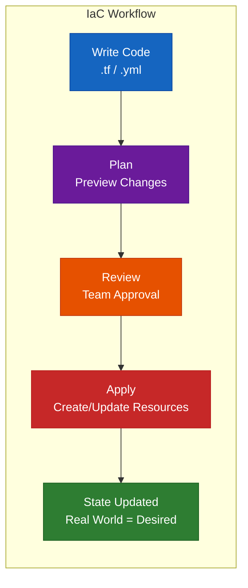

---

### 8.2 Terraform

| # | Topic | Subtopics | Key Concepts |
|---|---|---|---|
| 8.2.1 | 🔧 HCL Basics | Blocks, Arguments, Expressions | `resource`, `data`, `variable`, `output`, `locals` |
| 8.2.2 | 🔧 Core Workflow | `terraform init` → `plan` → `apply` → `destroy` | State management, execution plan, resource life cycle |
| 8.2.3 | 🔧 Providers | AWS, Azure, GCP, Kubernetes, Docker, etc. | Provider configuration, version constraints |
| 8.2.4 | 🔧 Resources & Data Sources | `resource` (create), `data` (read existing) | Resource dependencies, implicit vs explicit (`depends_on`) |
| 8.2.5 | 🔧 Variables & Outputs | `variable` block, `terraform.tfvars`, `-var`, `output` | Type constraints, default values, validation |
| 8.2.6 | 🔧 State Management | Local state, Remote state (S3 + DynamoDB), State locking | `terraform state list`, `terraform state show`, import/move |
| 8.2.7 | 📐 Modules | Reusable components, module registry | Root module, child modules, module inputs/outputs |
| 8.2.8 | 📐 Workspaces | `terraform workspace new/select` | Dev/staging/prod isolation with same code |
| 8.2.9 | 📐 Best Practices | Directory structure, naming conventions, tagging | Separate state per environment, use remote state, version lock providers |
| 8.2.10 | 🔧 Terraform Cloud / Enterprise | Remote execution, state management, team workflows | VCS integration, runs, policy enforcement (Sentinel) |

---

### 8.3 Configuration Management (Ansible)

| # | Topic | Subtopics | Key Concepts |
|---|---|---|---|
| 8.3.1 | 📖 Ansible Architecture | Agentless, SSH-based, push model | Control node → target nodes via SSH |
| 8.3.2 | 🔧 Inventory | Static (`hosts`), Dynamic (cloud APIs) | Groups, host variables, patterns |
| 8.3.3 | 🔧 Ad-hoc Commands | `ansible all -m ping`, `ansible web -m shell -a "uptime"` | Quick tasks without playbooks |
| 8.3.4 | 🔧 Playbooks | YAML tasks, plays, handlers | `tasks:`, `handlers:`, `notify:`, `when:` conditionals |
| 8.3.5 | 🔧 Roles | Directory structure, `tasks/`, `templates/`, `vars/`, `defaults/` | Reusable, shareable, Ansible Galaxy |
| 8.3.6 | 🔧 Templates (Jinja2) | Variables, loops, conditionals in config files | `{{ variable }}`, `` |
| 8.3.7 | 🔧 Ansible Vault | Encrypt secrets, `ansible-vault encrypt/decrypt/edit` | Protect sensitive variables |

---

### 8.4 Other IaC Tools

| # | Tool | Approach | When to Use |
|---|---|---|---|
| 8.4.1 | Pulumi | Code-based (Python, Go, TypeScript) | When you prefer real programming languages over HCL |
| 8.4.2 | AWS CloudFormation / CDK | AWS-native, JSON/YAML or TypeScript | AWS-only environments |
| 8.4.3 | Chef | Ruby-based, pull model | Legacy enterprise environments |
| 8.4.4 | Puppet | Ruby-based, pull model | Large-scale configuration management |
| 8.4.5 | OpenTofu | Open-source Terraform fork | BSL license concerns with Terraform |
| 8.4.6 | 🔧 **Packer** | Machine image builder (AMIs, VM images, Docker) | Template → provision → snapshot; Immutable infrastructure; HCL2 syntax |

---

### 8.5 IaC Testing & Validation

| # | Topic | Subtopics | Key Concepts |
|---|---|---|---|
| 8.5.1 | 🔧 Terratest | Go-based infrastructure testing framework | Deploy real infra → validate → destroy; integration tests for Terraform |
| 8.5.2 | 🔧 tfsec / Trivy Config | Static analysis for Terraform | Detect misconfigurations (public S3, open security groups) before apply |
| 8.5.3 | 🔧 Checkov | Policy-as-code scanner for IaC | Supports Terraform, CloudFormation, K8s, Docker; 1000+ built-in policies |
| 8.5.4 | 🔧 terraform validate / plan | Built-in validation | Syntax check, execution plan review, drift detection |
| 8.5.5 | 📐 OPA / Conftest | Policy testing for structured data | Write Rego policies to validate Terraform plans, K8s manifests, Dockerfiles |
| 8.5.6 | 📐 Infracost | Cloud cost estimation from Terraform | Show cost impact of changes in PRs; shift cost-awareness left |

> 🔗 **References:**
> - Terraform Documentation — https://developer.hashicorp.com/terraform/docs
> - Terraform Up and Running (Yevgeniy Brikman) — Book
> - Ansible Documentation — https://docs.ansible.com/
> - Packer Documentation — https://developer.hashicorp.com/packer/docs
> - Checkov — https://www.checkov.io/
> - Terratest — https://terratest.gruntwork.io/

---

## Phase 9 — Container Orchestration (Kubernetes)

### 9.1 Kubernetes Architecture

| # | Topic | Subtopics | Key Concepts |
|---|---|---|---|
| 9.1.1 | 📖 Why Kubernetes | Scheduling, scaling, self-healing, service discovery | Orchestrate thousands of containers across many nodes |
| 9.1.2 | 📖 Control Plane | API Server, etcd, Scheduler, Controller Manager | API Server = gateway; etcd = cluster state store |
| 9.1.3 | 📖 Worker Nodes | kubelet, kube-proxy, Container Runtime | kubelet manages pods; kube-proxy manages networking |
| 9.1.4 | 📖 Cluster Architecture | Master(s) + Workers, High Availability setup | Multi-master for production, etcd clustering |

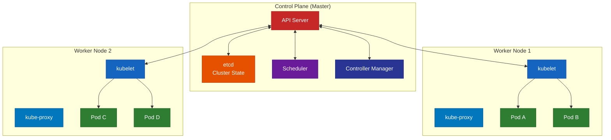

---

### 9.2 Core Objects & Workloads

| # | Object | Purpose | Key Concepts |
|---|---|---|---|
| 9.2.1 | 🔧 Pod | Smallest deployable unit (1+ containers) | Shared network namespace, localhost communication, sidecar pattern |
| 9.2.2 | 🔧 ReplicaSet | Maintain N replicas of a Pod | Selector-based, self-healing (restart failed pods) |
| 9.2.3 | 🔧 Deployment | Declarative updates for Pods/ReplicaSets | Rolling update, rollback (`kubectl rollout undo`), revision history |
| 9.2.4 | 🔧 Service | Stable network endpoint for Pods | ClusterIP (internal), NodePort (external), LoadBalancer (cloud LB) |
| 9.2.5 | 🔧 Ingress | HTTP(S) routing to Services | Host-based, path-based routing, TLS termination, Ingress controllers |
| 9.2.6 | 🔧 ConfigMap | External configuration (non-sensitive) | Inject as env vars or mounted files |
| 9.2.7 | 🔧 Secret | Sensitive data (base64 encoded) | Inject as env vars or mounted files, encryption at rest |
| 9.2.8 | 🔧 Namespace | Logical cluster partitioning | Resource isolation, RBAC boundaries, default/kube-system/kube-public |
| 9.2.9 | 🔧 DaemonSet | Run Pod on every (or selected) node | Monitoring agents, log collectors, node-level tasks |
| 9.2.10 | 🔧 StatefulSet | Stateful applications with stable identity | Stable hostname, ordered deployment, persistent storage per replica |
| 9.2.11 | 🔧 Job & CronJob | One-time or scheduled tasks | Batch processing, backups, report generation |
| 9.2.12 | 🔧 HorizontalPodAutoscaler (HPA) | Auto-scale based on metrics | CPU/memory thresholds, custom metrics |
| 9.2.13 | 📐 VerticalPodAutoscaler (VPA) | Right-size resource requests automatically | Recommendation mode, auto-update mode, avoid with HPA on same metric |
| 9.2.14 | 📐 PodDisruptionBudget (PDB) | Ensure min availability during disruptions | `minAvailable`, `maxUnavailable`, voluntary vs involuntary disruptions |

---

### 9.3 Networking in Kubernetes

| # | Topic | Subtopics | Key Concepts |
|---|---|---|---|
| 9.3.1 | 📖 Networking Model | Pod-to-Pod, Pod-to-Service, External-to-Service | Every Pod gets its own IP, flat network |
| 9.3.2 | 📖 CNI Plugins | Calico, Flannel, Cilium, Weave | Network policy enforcement, eBPF-based (Cilium) |
| 9.3.3 | 🔧 Network Policies | Ingress/Egress rules per Pod label | Default deny, whitelist approach, namespace isolation |
| 9.3.4 | 📖 Service Mesh | Istio, Linkerd | mTLS, traffic management, observability, circuit breaking |
| 9.3.5 | 📖 Gateway API | Successor to Ingress | Routes (HTTPRoute, TCPRoute), GatewayClass |

---

### 9.3A Scheduling & Node Management

| # | Topic | Subtopics | Key Concepts |
|---|---|---|---|
| 9.3A.1 | 📐 Taints & Tolerations | Node taints, Pod tolerations | `NoSchedule`, `PreferNoSchedule`, `NoExecute` — restrict which Pods run on which nodes |
| 9.3A.2 | 📐 Node Affinity | `nodeAffinity` (required/preferred), `nodeSelector` | Schedule Pods on nodes with specific labels (e.g., `disktype=ssd`) |
| 9.3A.3 | 📐 Pod Affinity & Anti-Affinity | `podAffinity`, `podAntiAffinity` | Co-locate related Pods; spread replicas across zones/nodes |
| 9.3A.4 | 📐 Topology Spread Constraints | `topologySpreadConstraints` | Even distribution across zones/nodes, `maxSkew`, `whenUnsatisfiable` |
| 9.3A.5 | 📐 Priority & Preemption | PriorityClass, preemption | High-priority Pods can evict lower-priority ones |
| 9.3A.6 | 🔧 Node Cordoning & Draining | `kubectl cordon`, `kubectl drain` | Graceful node maintenance, respects PDB |

---

### 9.4 Storage & State Management

| # | Topic | Subtopics | Key Concepts |
|---|---|---|---|
| 9.4.1 | 📖 Volume Types | emptyDir, hostPath, PersistentVolume (PV) | Ephemeral vs persistent, CSI drivers |
| 9.4.2 | 🔧 PV & PVC | PersistentVolume, PersistentVolumeClaim | Storage classes, dynamic provisioning, access modes (RWO, ROX, RWX) |
| 9.4.3 | 📐 StatefulSet + PVC | Volumetemplate for per-replica storage | Database clusters (PostgreSQL, MongoDB, Elasticsearch) |

---

### 9.5 Helm & Package Management

| # | Topic | Subtopics | Key Concepts |
|---|---|---|---|
| 9.5.1 | 🔧 Helm Basics | Charts, Values, Templates, Releases | `helm install`, `helm upgrade`, `helm rollback` |
| 9.5.2 | 🔧 Chart Structure | `Chart.yaml`, `values.yaml`, `templates/` | Go templating, `{{ .Values.replicas }}` |
| 9.5.3 | 🔧 Helm Repositories | Artifact Hub, Bitnami, custom repos | `helm repo add`, `helm search repo` |
| 9.5.4 | 📐 Kustomize (Alternative) | Overlay-based customization, no templating | `kustomization.yaml`, patches, bases + overlays |

---

### 9.6 Kubernetes Security (RBAC, Policies)

| # | Topic | Subtopics | Key Concepts |
|---|---|---|---|
| 9.6.1 | 🔧 RBAC | Roles, ClusterRoles, RoleBindings, ClusterRoleBindings | Principle of least privilege, ServiceAccounts |
| 9.6.2 | 📐 Pod Security | SecurityContext, Pod Security Standards (PSS) | Run as non-root, read-only root filesystem, drop capabilities |
| 9.6.3 | 🔧 Network Policies | Restrict Pod-to-Pod communication | Default deny, namespace isolation |
| 9.6.4 | 📐 Policy Engines | OPA Gatekeeper, Kyverno | Enforce policies at admission time |
| 9.6.5 | 🔧 Secrets Management | External Secrets Operator, Sealed Secrets, Vault integration | Sync secrets from Vault/AWS Secrets Manager into Kubernetes |
| 9.6.6 | 📐 Admission Controllers | Validating & Mutating webhooks | Built-in (LimitRanger, PodSecurity) + custom (OPA, Kyverno) — intercept API requests |
| 9.6.7 | 📐 CIS Benchmarks | kube-bench, CIS Kubernetes Benchmark | Automated security auditing of K8s clusters |
| 9.6.8 | 📐 AppArmor & Seccomp | Kernel-level security profiles | Restrict syscalls (seccomp), restrict file/network access (AppArmor) |

---

### 9.7 Kubernetes Operations

| # | Topic | Subtopics | Key Concepts |
|---|---|---|---|
| 9.7.1 | 🔧 kubectl Mastery | `get`, `describe`, `logs`, `exec`, `apply`, `delete`, `port-forward` | `--all-namespaces`, `-o yaml`, `-o jsonpath`, `--watch` |
| 9.7.2 | 🔧 Troubleshooting | Pod (Pending/CrashLoopBackOff/ImagePullErr), Service, DNS | `kubectl describe`, `kubectl logs --previous`, event analysis |
| 9.7.3 | 📐 Resource Limits | CPU/Memory requests and limits | QoS classes (Guaranteed, Burstable, BestEffort), OOM kills |
| 9.7.4 | 📐 Cluster Upgrades | kubeadm upgrade, managed K8s upgrades | Control plane → node drain → kubelet upgrade → uncordon |
| 9.7.5 | 🔧 Backup & DR | etcd backup, Velero | `etcdctl snapshot save`, cluster recovery |

> ⚡ **Interview Focus:** A Pod is in CrashLoopBackOff. Walk through your debugging steps.

> 🔗 **References:**
> - Kubernetes Documentation — https://kubernetes.io/docs/
> - Kubernetes the Hard Way — https://github.com/kelseyhightower/kubernetes-the-hard-way
> - CKA Certification Course (Mumshad/KodeKloud) — https://kodekloud.com
> - KillerCoda Interactive Labs — https://killercoda.com/
> - kind (Kubernetes in Docker) — https://kind.sigs.k8s.io/
> - minikube — https://minikube.sigs.k8s.io/

---

### 9.8 Kubernetes Operators & CRDs

| # | Topic | Subtopics | Key Concepts |
|---|---|---|---|
| 9.8.1 | 📖 Custom Resource Definitions (CRDs) | Extend K8s API with custom objects | Define new resource types (e.g., `PostgreSQLCluster`), `kubectl get <custom>` |
| 9.8.2 | 📖 Operator Pattern | Controller + CRD = automated operations | Encode operational knowledge: backup, upgrade, failover |
| 9.8.3 | 🔧 Popular Operators | Prometheus Operator, Postgres Operator, Strimzi (Kafka) | Operator Hub: https://operatorhub.io/ |
| 9.8.4 | 📐 Building Operators | Operator SDK (Go, Ansible, Helm), Kubebuilder | Reconciliation loop, watch → compare → act |
| 9.8.5 | 📐 Operator Maturity Model | Level 1 (Install) → Level 5 (Auto Pilot) | Capability levels: install, upgrade, lifecycle, insights, autopilot |

---

### 9.9 Service Mesh Deep Dive

| # | Topic | Subtopics | Key Concepts |
|---|---|---|---|
| 9.9.1 | 📖 What is a Service Mesh | Data plane (proxies) + Control plane (config) | Solve networking, security, observability for microservices |
| 9.9.2 | 📐 Sidecar vs Ambient | Sidecar proxy per Pod vs Shared node proxy | Sidecar: Istio classic, Linkerd; Ambient: Istio ambient mesh (no sidecar) |
| 9.9.3 | 🔧 Istio | VirtualService, DestinationRule, Gateway, PeerAuthentication | Traffic splitting, fault injection, circuit breaking, mTLS |
| 9.9.4 | 🔧 Linkerd | Lightweight, Rust-based proxy, minimal config | Auto-inject, tap (live traffic inspection), service profiles |
| 9.9.5 | 📖 Envoy Proxy | L4/L7 proxy, xDS API, filters, observability | Foundation for Istio; also used standalone, in API gateways |
| 9.9.6 | 📐 Traffic Management | Canary, A/B, blue-green, mirroring | Weight-based routing, header-based routing, traffic mirroring for testing |
| 9.9.7 | 📐 mTLS Everywhere | Automatic certificate rotation, zero-trust networking | Encrypt all service-to-service communication by default |
| 9.9.8 | 📐 Observability Features | Distributed tracing, golden metrics per service, access logs | Automatic telemetry without code changes |

---

## Phase 10 — Monitoring, Logging & Observability

### 10.1 Observability Concepts (Three Pillars)

| # | Pillar | What it Answers | Tools |
|---|---|---|---|
| 10.1.1 | 📖 Metrics | "What is happening?" — Numeric data over time | Prometheus, Datadog, CloudWatch |
| 10.1.2 | 📖 Logs | "Why did it happen?" — Event records | ELK, Loki, Splunk |
| 10.1.3 | 📖 Traces | "Where did it happen?" — Request journey across services | Jaeger, Zipkin, AWS X-Ray |

```mermaid
graph TB
    subgraph "Three Pillars of Observability"
        M[📊 Metrics<br/>CPU: 85%<br/>Requests: 1200/s<br/>Errors: 2%]
        L["📝 Logs<br/>ERROR: Connection refused<br/>at db.connect#40;#41; line 42<br/>timestamp: 2026-02-25T10:30:00Z"]
        T[🔗 Traces<br/>Request → API Gateway<br/>→ Auth Service (50ms)<br/>→ DB Query (200ms)<br/>→ Response (260ms)]
    end

    M --> D[Dashboard & Alerts]
    L --> D
    T --> D
    D --> R[Root Cause Analysis]

    style M fill:#1565c0,stroke:#0d47a1,color:#ffffff
    style L fill:#2e7d32,stroke:#1b5e20,color:#ffffff
    style T fill:#6a1b9a,stroke:#4a148c,color:#ffffff
    style D fill:#e65100,stroke:#bf360c,color:#ffffff
    style R fill:#c62828,stroke:#b71c1c,color:#ffffff
```

---

### 10.2 Metrics — Prometheus & Grafana

| # | Topic | Subtopics | Key Concepts |
|---|---|---|---|
| 10.2.1 | 📖 Prometheus Architecture | Pull model, scrape targets, time-series DB | Scrape interval, metric types (counter, gauge, histogram, summary) |
| 10.2.2 | 🔧 PromQL | Querying language | `rate()`, `sum()`, `avg()`, `histogram_quantile()`, label selectors |
| 10.2.3 | 🔧 Exporters | Node Exporter, Blackbox Exporter, custom exporters | Expose metrics in Prometheus format (`/metrics` endpoint) |
| 10.2.4 | 🔧 Alertmanager | Alert routing, grouping, silencing, inhibition | PagerDuty, Slack, email integration |
| 10.2.5 | 🔧 Grafana | Dashboards, panels, variables, annotations | Data sources (Prometheus, Loki, InfluxDB), template variables |
| 10.2.6 | 📐 RED Method | Rate, Errors, Duration — for request-driven services | "For every service, monitor these three" |
| 10.2.7 | 📐 USE Method | Utilization, Saturation, Errors — for resources | "For every resource (CPU, memory, disk), monitor these three" |
| 10.2.8 | 📐 Prometheus at Scale | Federation, Thanos, Mimir (Grafana) | Multi-cluster metrics aggregation, long-term storage, global querying |

---

### 10.3 Logging — ELK / Loki

| # | Topic | Subtopics | Key Concepts |
|---|---|---|---|
| 10.3.1 | 📖 ELK Stack | Elasticsearch + Logstash + Kibana | Elasticsearch: search engine; Logstash: ingest pipeline; Kibana: visualization |
| 10.3.2 | 📖 Loki + Grafana | Log aggregation (label-based, not full-text indexed) | Lightweight alternative to ELK, pairs with Grafana |
| 10.3.3 | 🔧 Log Collection | Filebeat, Fluentd, Fluent Bit, Promtail | Sidecar pattern, DaemonSet pattern, log forwarding |
| 10.3.4 | 📐 Structured Logging | JSON logs, key-value fields | Machine-parseable, filterable, correlatable |
| 10.3.5 | 📐 Log Levels | DEBUG, INFO, WARN, ERROR, FATAL | Production: INFO+; Debugging: DEBUG; Log level management |
| 10.3.6 | 📐 Log Retention | Rotation, archival, lifecycle policies | Cost vs compliance vs troubleshooting needs |

---

### 10.4 Tracing — Jaeger / OpenTelemetry

| # | Topic | Subtopics | Key Concepts |
|---|---|---|---|
| 10.4.1 | 📖 Distributed Tracing | Trace ID, Span ID, Parent Span | Follow a request across microservices |
| 10.4.2 | 🔧 OpenTelemetry (OTel) | SDKs, Collector, Exporters | Vendor-neutral instrumentation standard (CNCF) |
| 10.4.3 | 🔧 Jaeger | Trace visualization, dependency graph | Span timeline, latency analysis, service map |

---

### 10.5 Alerting & Incident Response

| # | Topic | Subtopics | Key Concepts |
|---|---|---|---|
| 10.5.1 | 📐 Alert Design | Symptom-based (not cause-based), actionable alerts | Avoid alert fatigue, every alert = action required |
| 10.5.2 | 📖 SLI / SLO / SLA | Service Level Indicator / Objective / Agreement | SLI: measurement; SLO: target; SLA: contract — *see [§13.4 SRE Practices](#134-sre-practices) for deep dive* |
| 10.5.3 | 📖 Error Budgets | Allowed failures within SLO | 99.9% SLO = 43.8 min/month downtime budget |
| 10.5.4 | 📐 On-Call & Escalation | Rotation, runbooks, escalation chains | PagerDuty, OpsGenie, defined response protocols |
| 10.5.5 | 📐 Post-Incident Review | Blameless postmortems, timeline, root cause, action items | Focus on process improvement, not blame |

> 🔗 **References:**
> - Prometheus Documentation (official) — https://prometheus.io/docs/
> - Grafana Documentation (official) — https://grafana.com/docs/
> - OpenTelemetry Documentation (CNCF official) — https://opentelemetry.io/docs/
> - Elastic (ELK) Documentation — https://www.elastic.co/guide/
> - Site Reliability Engineering — Google (free online) — https://sre.google/sre-book/

---

## Phase 11 — Security (DevSecOps)

### 11.1 Security Mindset & Principles

| # | Topic | Subtopics | Key Concepts |
|---|---|---|---|
| 11.1.1 | 📖 Defense in Depth | Multiple layers of security | No single point of failure in security |
| 11.1.2 | 📖 Principle of Least Privilege | Minimal permissions required | Users, services, containers — only what they need |
| 11.1.3 | 📖 Zero Trust | Never trust, always verify | Authenticate every request, even internal |
| 11.1.4 | 📖 Shift-Left Security | Test security early in pipeline | SAST in CI, policy enforcement at build time |
| 11.1.5 | 📖 OWASP Top 10 | Most critical web application security risks | Injection, Broken Auth, Sensitive Data, XSS, etc. |

---

### 11.2 Secrets Management

| # | Topic | Subtopics | Key Concepts |
|---|---|---|---|
| 11.2.1 | 📖 Why Secrets Management | Passwords, API keys, tokens, certificates | NEVER in code, NEVER in git, NEVER in environment unencrypted |
| 11.2.2 | 🔧 HashiCorp Vault | Dynamic secrets, leasing, rotation | Secret engines, auth methods, policies |
| 11.2.3 | 🔧 Cloud Secrets | AWS Secrets Manager, Azure Key Vault, GCP Secret Manager | Automatic rotation, IAM-based access control |
| 11.2.4 | 🔧 .env & dotenv | Development-only secret injection | `.env` in `.gitignore`, never commit secrets |
| 11.2.5 | 🔧 git-secrets / gitleaks | Pre-commit hooks to prevent secret leaks | Scan commits before push |

---

### 11.3 Image & Code Scanning

| # | Topic | Subtopics | Key Concepts |
|---|---|---|---|
| 11.3.1 | 🔧 Container Image Scanning | Trivy, Snyk Container, Docker Scout | CVE detection, base image vulnerabilities, fix recommendations |
| 11.3.2 | 🔧 SAST | SonarQube, Semgrep, CodeQL | Scan source code for vulnerabilities without executing it |
| 11.3.3 | 🔧 DAST | OWASP ZAP, Burp Suite | Test running application for vulnerabilities |
| 11.3.4 | 🔧 SCA | Dependency scanning, license compliance | Known vulnerabilities in third-party libraries |
| 11.3.5 | 📐 Software Bill of Materials (SBOM) | Inventory of all components | SPDX, CycloneDX formats, supply chain security |

---

### 11.3A Supply Chain Security

| # | Topic | Subtopics | Key Concepts |
|---|---|---|---|
| 11.3A.1 | 📐 SLSA Framework | Supply-chain Levels for Software Artifacts | Levels 1-4: from basic provenance to hermetic, reproducible builds |
| 11.3A.2 | 🔧 Sigstore / Cosign | Keyless signing of container images | Sign images in CI; verify signatures before deploy; Fulcio + Rekor transparency log |
| 11.3A.3 | 📐 Image Provenance | Attestations, build metadata | Notary v2, in-toto attestations, verify build origin |
| 11.3A.4 | 📐 Dependency Pinning | Lock files, hash verification | `requirements.txt` with hashes, `package-lock.json`, Renovate/Dependabot auto-updates |

---

### 11.3B Runtime Security

| # | Topic | Subtopics | Key Concepts |
|---|---|---|---|
| 11.3B.1 | 🔧 Falco | Runtime threat detection for K8s | Kernel-level syscall monitoring, detect anomalous behavior (shell in container, unexpected network) |
| 11.3B.2 | 🔧 Sysdig Secure | Runtime security + compliance + forensics | Image scanning + runtime detection + audit trail |
| 11.3B.3 | 📐 eBPF-based Security | Cilium Tetragon, Tracee | Kernel-level observability and enforcement without kernel modules |
| 11.3B.4 | 📐 Runtime Policy Enforcement | Restrict file access, network connections, process execution | Block reverse shells, unauthorized binary execution, data exfiltration |

---

### 11.4 Network Security

| # | Topic | Subtopics | Key Concepts |
|---|---|---|---|
| 11.4.1 | 📐 Network Segmentation | VPCs, subnets, security groups | Public subnet (web) → Private subnet (app) → Private subnet (DB) |
| 11.4.2 | 📐 WAF | Web Application Firewall | AWS WAF, Cloudflare WAF — block SQL injection, XSS |
| 11.4.3 | 📐 VPN | Site-to-site, Client VPN | Secure remote access to infrastructure |
| 11.4.4 | 📐 mTLS | Mutual TLS between services | Both client and server present certificates |

---

### 11.5 Compliance & Auditing

| # | Topic | Subtopics | Key Concepts |
|---|---|---|---|
| 11.5.1 | 📖 Standards | SOC 2, ISO 27001, GDPR, HIPAA, PCI-DSS | Which applies depends on industry and geography |
| 11.5.2 | 📐 Audit Logging | Who did what, when, from where | CloudTrail (AWS), Activity Log (Azure), Audit Logs (K8s) |
| 11.5.3 | 📐 Policy as Code | OPA, Kyverno, Sentinel | Automate compliance checks in CI/CD and at runtime |

> 🔗 **References:**
> - OWASP DevSecOps Guideline — https://owasp.org/www-project-devsecops-guideline/
> - Trivy Documentation — https://trivy.dev/
> - HashiCorp Vault Docs — https://developer.hashicorp.com/vault/docs
> - SLSA Framework — https://slsa.dev/
> - Sigstore — https://www.sigstore.dev/
> - Falco — https://falco.org/

---

## Phase 12 — Databases for DevOps

### 12.1 RDBMS Fundamentals

| # | Topic | Subtopics | Key Concepts |
|---|---|---|---|
| 12.1.1 | 📖 Relational Concepts | Tables, Rows, Columns, Keys (PK, FK), Indexes | Schema design, normalization (1NF, 2NF, 3NF) |
| 12.1.2 | 🔧 SQL Essentials | SELECT, INSERT, UPDATE, DELETE, JOIN, GROUP BY, WHERE | Aggregations, subqueries, transactions (ACID) |
| 12.1.3 | 🔧 PostgreSQL | Installation, psql CLI, roles, databases | Extensions (PostGIS, pg_stat), EXPLAIN ANALYZE |
| 12.1.4 | 🔧 MySQL/MariaDB | Installation, mysql CLI, users, privileges | InnoDB, storage engines, replication |

---

### 12.2 NoSQL Databases

| # | Topic | Subtopics | Key Concepts |
|---|---|---|---|
| 12.2.1 | 📖 NoSQL Categories | Document, Key-Value, Column-family, Graph | Each optimized for different access patterns |
| 12.2.2 | 🔧 MongoDB | Documents, Collections, BSON, Aggregation pipeline | When to use: flexible schema, rapid iteration |
| 12.2.3 | 🔧 Redis | In-memory key-value, data types, pub/sub | Caching, session store, rate limiting, queues |
| 12.2.4 | 📖 CAP Theorem | Consistency, Availability, Partition Tolerance | Pick 2 of 3 during network partitions |

---

### 12.3 Database Operations

| # | Topic | Subtopics | Key Concepts |
|---|---|---|---|
| 12.3.1 | 🔧 Backup & Restore | `pg_dump`, `mysqldump`, scheduled backups | Point-in-time recovery, WAL archiving, automated backup scripts |
| 12.3.2 | 🔧 Replication | Primary-Replica, Master-Slave, Multi-Master | Read replicas for scaling reads, failover |
| 12.3.3 | 📐 Connection Pooling | PgBouncer, ProxySQL | Reduce connection overhead, manage pool sizes |
| 12.3.4 | 📐 Database Migrations | Schema evolution, migration tools | Alembic (Python), Flyway (Java), Knex (JS), versioned migrations |
| 12.3.5 | 📐 Performance Tuning | Indexing, Query optimization, EXPLAIN | Slow query log, index selection, query plan analysis |

> 🔗 **References:**
> - PostgreSQL Documentation — https://www.postgresql.org/docs/
> - Redis University — https://university.redis.com/
> - MongoDB University — https://learn.mongodb.com/

---

## Phase 13 — Software Engineering Practices

### 13.1 SDLC & Agile/Scrum

| # | Topic | Subtopics | Key Concepts |
|---|---|---|---|
| 13.1.1 | 📖 SDLC Models | Waterfall, Agile, Spiral, V-Model | Each model's phases, when to use which |
| 13.1.2 | 📖 Agile Manifesto | 4 Values, 12 Principles | Individuals > processes, Working software > docs, Collaboration > contracts |
| 13.1.3 | 📖 Scrum | Sprints, Roles (PO, SM, Team), Ceremonies | Sprint Planning, Daily Standup, Review, Retrospective |
| 13.1.4 | 📖 Kanban | Visual board, WIP limits, flow | Continuous delivery, no fixed sprints |
| 13.1.5 | 🔧 Work Tracking Tools | Jira, Azure Boards, Trello, Linear | Epics → Stories → Tasks, burndown charts |

---

### 13.2 System Design Fundamentals

| # | Topic | Subtopics | Key Concepts |
|---|---|---|---|
| 13.2.1 | 📐 Scalability | Horizontal vs Vertical scaling | Scale out (more servers) vs Scale up (bigger server) |
| 13.2.2 | 📐 High Availability | Redundancy, failover, replication | Multi-AZ, active-passive, active-active |
| 13.2.3 | 📐 Disaster Recovery | RPO, RTO, backup strategies | RPO: how much data loss acceptable; RTO: how fast to recover |
| 13.2.4 | 📐 Microservices vs Monolith | Tradeoffs, decomposition patterns | Start monolith, decompose when complexity demands |
| 13.2.5 | 📐 12-Factor App | Methodology for building SaaS apps | Codebase, Dependencies, Config, Backing services, Build/Release/Run, Processes, Port binding, Concurrency, Disposability, Dev/Prod parity, Logs, Admin processes |
| 13.2.6 | 📐 Message Queues | RabbitMQ, Kafka, SQS | Async processing, decoupling, event-driven architecture |
| 13.2.7 | 📐 API Design | REST, GraphQL, gRPC | Versioning, pagination, rate limiting, documentation (OpenAPI) |

---

### 13.3 Documentation & Communication

| # | Topic | Subtopics | Key Concepts |
|---|---|---|---|
| 13.3.1 | 📖 Technical Documentation | READMEs, ADRs, Runbooks, Architecture diagrams | Documentation-as-code, Mermaid/PlantUML, living docs |
| 13.3.2 | 📖 Runbooks | Step-by-step operational procedures | Incident response, deployment, rollback procedures |
| 13.3.3 | 📖 Architecture Decision Records | Template: Context, Decision, Consequences | Track why decisions were made |
| 13.3.4 | 📖 Communication Skills | Blameless culture, cross-team collaboration | Bridge between Dev and Ops teams |

---

### 13.4 SRE Practices

| # | Topic | Subtopics | Key Concepts |
|---|---|---|---|
| 13.4.1 | 📖 SRE vs DevOps | SRE = "class implements DevOps" | SRE is opinionated implementation of DevOps principles |
| 13.4.2 | 📖 SLI / SLO / SLA | Indicators, Objectives, Agreements | SLI: measurement (latency p99); SLO: target (99.9%); SLA: contract ($$ penalties) |
| 13.4.3 | 📖 Error Budgets | Balance reliability vs innovation | Under budget → ship faster; Over budget → focus on stability |
| 13.4.4 | 📖 Error Budget Policy | What happens when budget is burned | Freeze deployments, redirect engineering to reliability work |
| 13.4.5 | 📖 Toil | Repetitive, automatable, no lasting value | Reduce toil to <50% of engineer time; automate or eliminate |
| 13.4.6 | 📐 Toil Taxonomy | Identify, measure, track, eliminate | Classify: manual, repetitive, automatable, tactical, growing, no lasting value |
| 13.4.7 | 📐 Capacity Planning | Demand forecasting, resource provisioning | Load testing, trend analysis, organic vs inorganic growth |
| 13.4.8 | 📐 Release Engineering | Build, test, deploy automation | Hermetic builds, cherry-picks vs rollbacks, release cadence |
| 13.4.9 | 📐 Incident Command System (ICS) | Incident Commander, Comms Lead, Ops Lead | Clear roles during outages: IC makes decisions, Comms updates stakeholders |
| 13.4.10 | 📐 On-Call Practices | Rotation, compensation, handoff, escalation | Multi-tier on-call, runbooks, reduced toil, maximum alert frequency |
| 13.4.11 | 📐 Blameless Postmortems | Timeline, root cause, action items, lessons learned | Focus on systemic fixes, not individual blame; share publicly internal |
| 13.4.12 | 📐 SLO Workshops | Define SLIs with product owners, set SLO targets | Align engineering and business on reliability targets |
| 13.4.13 | 📐 DORA Metrics | Deployment Frequency, Lead Time, MTTR, Change Failure Rate | Measure engineering performance; Elite/High/Medium/Low bands |
| 13.4.14 | 📐 Reliability Testing | Load testing, chaos engineering, disaster recovery drills | Regular game days, automated failover testing |
| 13.4.15 | 📐 Managing Operational Overload | When ops work exceeds 50%, escalate to dev team | Temporary embedding of SRE in dev team, or hand back service |
| 13.4.16 | 📖 Google SRE Principles | "Hope is not a strategy", "Reliability is a feature" | Embrace risk, measure everything, automate toil, cap operational load |

> ⚡ **Interview Focus:** Your SLO is 99.95% uptime. Last month you had 99.92%. Walk through your incident response and error budget policy.

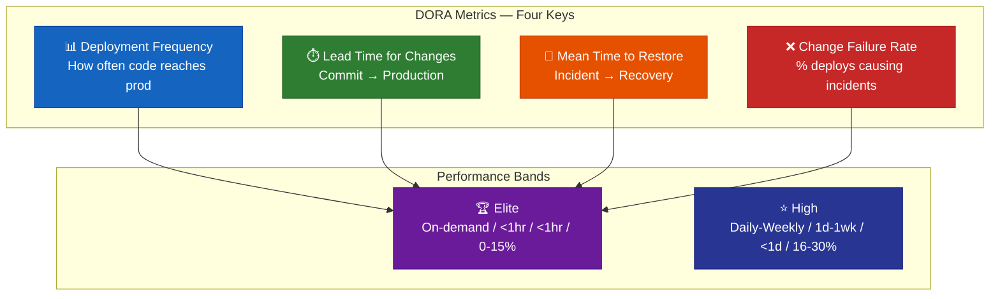

> 🔗 **References:**
> - The Phoenix Project — Gene Kim (Book, the DevOps culture classic)
> - Accelerate — Nicole Forsgren (Book, the science of DevOps / DORA metrics)
> - Agile Manifesto (official) — https://agilemanifesto.org/
> - 12-Factor App (Heroku official) — https://12factor.net/
> - Site Reliability Engineering — Google (free online) — https://sre.google/sre-book/
> - Martin Fowler's Architecture Blog — https://martinfowler.com/architecture/

---

## Phase 14 — Advanced & Emerging Fields

### 14.1 GitOps

| # | Topic | Subtopics | Key Concepts |
|---|---|---|---|
| 14.1.1 | 📖 GitOps Principles | Git as single source of truth, declarative, automated reconciliation | Push to Git → Cluster syncs automatically |
| 14.1.2 | 🔧 ArgoCD | Application CRD, sync policies, App of Apps | Declarative, GitOps-native continuous delivery for Kubernetes |
| 14.1.3 | 🔧 FluxCD | Source Controller, Kustomize Controller, Helm Controller | CNCF project, GitOps Toolkit |
| 14.1.4 | 📐 Repository Structure | App repo vs Config repo, environment branches/folders | Monorepo vs multi-repo, promote through envs |


---

### 14.2 Platform Engineering

| # | Topic | Subtopics | Key Concepts |
|---|---|---|---|
| 14.2.1 | 📖 What is Platform Engineering | Internal Developer Platform (IDP), self-service | Reduce cognitive load on developers |
| 14.2.2 | 📖 Golden Paths | Pre-built templates, recommended configurations | "Paved roads" — easy to follow, hard to deviate |
| 14.2.3 | 🔧 Backstage (Spotify) | Software catalog, scaffolder, tech docs, plugins | Internal developer portal, unified service catalog |
| 14.2.4 | 📐 Platform Teams | Team Topologies, enabling team model | Platform team enables stream-aligned teams |
| 14.2.5 | 📖 Developer Experience (DX) | Onboarding, documentation, tooling | Measure: time-to-first-deploy for new engineers |

---

### 14.3 Chaos Engineering

| # | Topic | Subtopics | Key Concepts |
|---|---|---|---|
| 14.3.1 | 📖 Principles of Chaos | Hypothesis, Blast radius, Steady state | "What happens when X fails?" — test before production disasters |
| 14.3.2 | 🔧 Chaos Monkey (Netflix) | Random instance termination | Validate auto-recovery and redundancy |
| 14.3.3 | 🔧 Litmus Chaos | Kubernetes-native chaos experiments | Pod kill, network delay, disk fill, CPU stress |
| 14.3.4 | 🔧 Gremlin | Enterprise chaos platform | Targeted attacks, game days, safety nets |
| 14.3.5 | 📐 Game Days | Planned chaos experiments with the team | Practice incident response, validate runbooks |

---

### 14.4 MLOps

| # | Topic | Subtopics | Key Concepts |
|---|---|---|---|
| 14.4.1 | 📖 ML Lifecycle | Data → Train → Evaluate → Deploy → Monitor → Retrain | Continuous training, data drift, model drift |
| 14.4.2 | 🔧 Model Versioning | DVC, MLflow, Weights & Biases | Track experiments, parameters, metrics, artifacts |
| 14.4.3 | 🔧 Model Serving | TensorFlow Serving, Triton, BentoML, Seldon | REST/gRPC inference endpoints, batching |
| 14.4.4 | 🔧 Training Pipelines | Kubeflow, SageMaker, Vertex AI | Orchestrate data prep → training → validation → deployment |
| 14.4.5 | 📐 GPU Infrastructure | NVIDIA Docker, K8s GPU scheduling | GPU node pools, resource limits, fractional GPUs |
| 14.4.6 | 📐 Feature Stores | Feast, Tecton | Reusable features, online vs offline serving |
| 14.4.7 | 📐 Model Monitoring | Evidently AI, WhyLabs | Data drift, prediction drift, model performance decay |

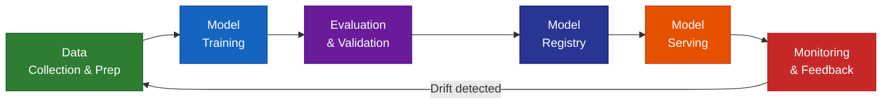

---

### 14.5 LLMOps

| # | Topic | Subtopics | Key Concepts |
|---|---|---|---|
| 14.5.1 | 📖 LLM Deployment | vLLM, TGI, Ollama | High-throughput inference, GPU memory management |
| 14.5.2 | 📐 RAG Infrastructure | Vector databases, embeddings, retrieval pipeline | ChromaDB, Pinecone, Weaviate + LLM |
| 14.5.3 | 📐 Prompt Engineering | Versioning, testing, A/B testing | Prompt templates, chain-of-thought, few-shot |
| 14.5.4 | 📐 Cost Optimization | Token management, caching, model selection | Smaller models for simpler tasks, semantic caching |
| 14.5.5 | 📐 Guardrails & Safety | Output filtering, hallucination detection | Responsible AI, content moderation pipelines |

---

### 14.6 DataOps

| # | Topic | Subtopics | Key Concepts |
|---|---|---|---|
| 14.6.1 | 📖 DataOps Concepts | CI/CD for data, data quality, data observability | Apply DevOps principles to data pipelines |
| 14.6.2 | 🔧 Orchestration | Apache Airflow, Prefect, Dagster | DAGs, task dependencies, scheduling, retries |
| 14.6.3 | 🔧 Data Transformation | dbt (data build tool) | SQL-based transforms, testing, documentation |
| 14.6.4 | 📐 Data Quality | Great Expectations, Soda | Schema validation, data profiling, anomaly detection |
| 14.6.5 | 📐 Data Lake / Warehouse | Snowflake, Databricks, BigQuery, Delta Lake | ELT patterns, medallion architecture (bronze/silver/gold) |

---

### 14.7 Edge & IoT DevOps

| # | Topic | Subtopics | Key Concepts |
|---|---|---|---|
| 14.7.1 | 📖 Edge Computing | Process data near source, reduce latency | CDN edge, IoT gateways, autonomous vehicles, drones |
| 14.7.2 | 🔧 Edge Kubernetes | K3s, KubeEdge, MicroK8s | Lightweight K8s for resource-constrained devices |
| 14.7.3 | 📐 OTA Updates | Over-the-air firmware/software updates | Rollback support, delta updates, fleet management |
| 14.7.4 | 📐 Fleet Management | Manage thousands of devices | Azure IoT Hub, AWS IoT Greengrass, balena |

---

### 14.8 FinOps (Cloud Cost Optimization)

| # | Topic | Subtopics | Key Concepts |
|---|---|---|---|
| 14.8.1 | 📖 FinOps Framework | Inform, Optimize, Operate | Visibility → Optimization → Governance |
| 14.8.2 | 📐 Cost Visibility | Tagging strategy, cost allocation, showback/chargeback | Tag every resource, track cost per team/service/environment |
| 14.8.3 | 📐 Optimization Techniques | Right-sizing, Reserved/Savings Plans, Spot instances | Unused resources, over-provisioned instances, scheduled shutdown |
| 14.8.4 | 🔧 Tools | AWS Cost Explorer, Azure Cost Management, Infracost, Kubecost | Automated cost alerts, budget thresholds |

> 🔗 **References:**
> - ArgoCD Documentation — https://argo-cd.readthedocs.io/
> - Backstage.io — https://backstage.io/
> - Principles of Chaos Engineering — https://principlesofchaos.org/
> - MLOps.org — https://ml-ops.org/
> - FinOps Foundation — https://www.finops.org/

---

## Appendix A — Certifications Roadmap

| Order | Certification | Provider | Level | Focus |
|---|---|---|---|---|
| 1 | AWS Cloud Practitioner (CLF-C02) | AWS | Foundational | Cloud concepts, billing, core services |
| 2 | AWS Solutions Architect Associate (SAA-C03) | AWS | Associate | Architecture, networking, compute, storage |
| 3 | Certified Kubernetes Administrator (CKA) | CNCF | Intermediate | K8s cluster admin, troubleshooting |
| 4 | HashiCorp Terraform Associate | HashiCorp | Associate | IaC, Terraform workflow, state, modules |
| 5 | Certified Kubernetes Security Specialist (CKS) | CNCF | Advanced | K8s security hardening |
| 6 | AWS DevOps Engineer Professional (DOP-C02) | AWS | Professional | CI/CD, automation, monitoring |
| 7 | Azure DevOps Engineer Expert (AZ-400) | Microsoft | Expert | Azure DevOps, pipelines, IaC |

---

## Appendix B — Recommended Books

| # | Book | Author(s) | Focus |
|---|---|---|---|
| 1 | The Phoenix Project | Gene Kim et al. | DevOps culture (novel) |
| 2 | The DevOps Handbook | Gene Kim et al. | DevOps practices, principles |
| 3 | Accelerate | Nicole Forsgren et al. | Science of DevOps performance (DORA metrics) |
| 4 | Continuous Delivery | Jez Humble, David Farley | Build, test, deploy automation |
| 5 | Site Reliability Engineering | Google | SRE practices, toil, SLOs |
| 6 | Kubernetes Up and Running | Kelsey Hightower et al. | Kubernetes fundamentals |
| 7 | Terraform: Up & Running | Yevgeniy Brikman | IaC with Terraform |
| 8 | Team Topologies | Skelton, Pais | Team organization for fast flow |
| 9 | Effective DevOps | Davis, Daniels | Culture, collaboration, tooling |
| 10 | Container Security | Liz Rice | Container & K8s security |
| 11 | Fundamentals of DevOps and Software Delivery | Yevgeniy Brikman | Hands-on guide, K8s, CI/CD, IaC |

---

## Appendix C — Hands-On Project Ideas

| # | Project | Skills Practiced | Difficulty |
|---|---|---|---|
| 1 | Automate server setup with Bash scripts | Linux, Bash, SSH | Beginner |
| 2 | Dockerize a multi-tier app (frontend + API + DB) | Docker, Compose, Networking | Beginner |
| 3 | Set up CI/CD for a GitHub repo with automated tests | GitHub Actions, Testing | Beginner |
| 4 | Deploy a web app on AWS EC2 behind Nginx with SSL | AWS, Nginx, Certbot, SSH | Intermediate |
| 5 | Provision AWS infrastructure with Terraform | Terraform, AWS VPC/EC2/RDS | Intermediate |
| 6 | Configure monitoring with Prometheus + Grafana | Prometheus, Grafana, Docker | Intermediate |
| 7 | Deploy a microservices app on Kubernetes | K8s, Helm, Ingress, Services | Intermediate |
| 8 | Build a full GitOps pipeline with ArgoCD | Git, ArgoCD, K8s, Helm | Advanced |
| 9 | Implement Chaos Engineering experiments | Litmus, K8s, observability | Advanced |
| 10 | Build an Internal Developer Portal with Backstage | Node.js, K8s, Backstage | Advanced |

---

## Appendix D — Tool Landscape Map

```mermaid
graph TB
    subgraph "Version Control"
        GIT[Git]
        GH[GitHub]
        GL[GitLab]
        BB[Bitbucket]
    end

    subgraph "CI/CD"
        GHA[GitHub Actions]
        GLCI[GitLab CI]
        JNK[Jenkins]
        CCI[CircleCI]
    end

    subgraph "Containers"
        DCK[Docker]
        PDM[Podman]
        CRD[containerd]
    end

    subgraph "Orchestration"
        K8S[Kubernetes]
        ECS[AWS ECS]
        SWM[Docker Swarm]
    end

    subgraph "IaC"
        TF[Terraform / OpenTofu]
        ANS[Ansible]
        PUL[Pulumi]
        CFN[CloudFormation]
    end

    subgraph "Cloud"
        AWS[AWS]
        AZR[Azure]
        GCP[GCP]
    end

    subgraph "Monitoring"
        PROM[Prometheus]
        GRAF[Grafana]
        ELK[ELK Stack]
        LOKI[Loki]
        DD[Datadog]
    end

    subgraph "Security"
        VAULT[Vault]
        TRIVY[Trivy]
        OPA[OPA / Gatekeeper]
    end

    subgraph "GitOps"
        ARGO[ArgoCD]
        FLUX[FluxCD]
    end

    GIT --> GH & GL & BB
    GH --> GHA
    GL --> GLCI
    DCK --> K8S
    K8S --> ARGO & FLUX
    TF --> AWS & AZR & GCP
    PROM --> GRAF
    LOKI --> GRAF

    style GIT fill:#37474f,stroke:#263238,color:#ffffff
    style GH fill:#37474f,stroke:#263238,color:#ffffff
    style GL fill:#37474f,stroke:#263238,color:#ffffff
    style BB fill:#37474f,stroke:#263238,color:#ffffff
    style GHA fill:#c62828,stroke:#b71c1c,color:#ffffff
    style GLCI fill:#c62828,stroke:#b71c1c,color:#ffffff
    style JNK fill:#c62828,stroke:#b71c1c,color:#ffffff
    style CCI fill:#c62828,stroke:#b71c1c,color:#ffffff
    style DCK fill:#1565c0,stroke:#0d47a1,color:#ffffff
    style PDM fill:#1565c0,stroke:#0d47a1,color:#ffffff
    style CRD fill:#1565c0,stroke:#0d47a1,color:#ffffff
    style K8S fill:#0277bd,stroke:#01579b,color:#ffffff
    style ECS fill:#0277bd,stroke:#01579b,color:#ffffff
    style SWM fill:#0277bd,stroke:#01579b,color:#ffffff
    style TF fill:#6a1b9a,stroke:#4a148c,color:#ffffff
    style ANS fill:#6a1b9a,stroke:#4a148c,color:#ffffff
    style PUL fill:#6a1b9a,stroke:#4a148c,color:#ffffff
    style CFN fill:#6a1b9a,stroke:#4a148c,color:#ffffff
    style AWS fill:#e65100,stroke:#bf360c,color:#ffffff
    style AZR fill:#e65100,stroke:#bf360c,color:#ffffff
    style GCP fill:#e65100,stroke:#bf360c,color:#ffffff
    style PROM fill:#2e7d32,stroke:#1b5e20,color:#ffffff
    style GRAF fill:#2e7d32,stroke:#1b5e20,color:#ffffff
    style ELK fill:#2e7d32,stroke:#1b5e20,color:#ffffff
    style LOKI fill:#2e7d32,stroke:#1b5e20,color:#ffffff
    style DD fill:#2e7d32,stroke:#1b5e20,color:#ffffff
    style VAULT fill:#ad1457,stroke:#880e4f,color:#ffffff
    style TRIVY fill:#ad1457,stroke:#880e4f,color:#ffffff
    style OPA fill:#ad1457,stroke:#880e4f,color:#ffffff
    style ARGO fill:#283593,stroke:#1a237e,color:#ffffff
    style FLUX fill:#283593,stroke:#1a237e,color:#ffffff
```

---

## Appendix E — DevOps Job Market Research (2025–2026)

> Data sourced from Indeed, AmbitionBox, U.S. Bureau of Labor Statistics, and industry reports. Last updated: **February 2026**.

### Global Market Overview

| Metric | Data | Source |
|---|---|---|
| **Global DevOps Market Size (2025)** | ~$12.9 Billion | Industry Estimates |
| **Projected Market Size (2030)** | ~$37 Billion | CAGR ~24% |
| **Software Dev Job Growth (2024–2034)** | **15%** — "Much faster than average" | U.S. Bureau of Labor Statistics |
| **Annual Openings (SW Dev/QA/Testing, US)** | ~129,200 / year | BLS |
| **Total SW Dev Jobs in US (2024)** | 1,895,500 | BLS |
| **DevOps-specific Job Openings (India)** | 12,200+ active listings | AmbitionBox (Feb 2026) |
| **Average Salary Growth (India, 2yr)** | **+22%** over last 2 years | AmbitionBox |

### Salary Data — United States

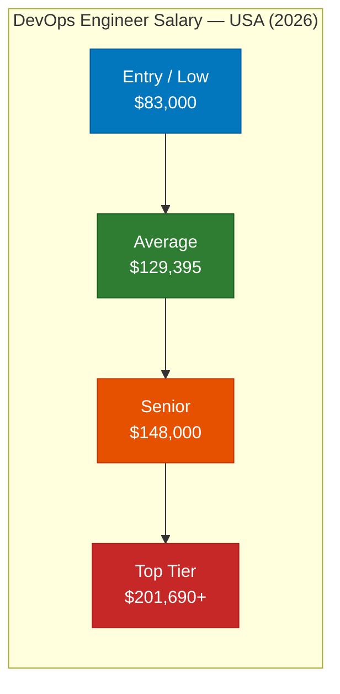

| Level | Average Annual Salary (USD) | Source |
|---|---|---|
| DevOps Engineer (avg) | **$129,395** | Indeed (Feb 2026) |
| Senior DevOps Engineer | **$148,034** | Indeed |
| Range (Low – High) | $83,013 – $201,690 | Indeed |

**Highest Paying US Companies:**

| Company | Annual Compensation |
|---|---|
| Siemens | $301,600 |
| SAIC | $271,750 |
| Renesas | $270,000 |
| Grammarly | $267,000 |
| Dow Jones | $265,000 |

**Highest Paying US Cities:**

| City | Average Salary |
|---|---|
| Palo Alto, CA | $167,289 |
| New York, NY | $140,225 |
| Chicago, IL | $138,762 |
| Washington, DC | $135,804 |
| Irving, TX | $127,417 |

---

### Salary Data — India

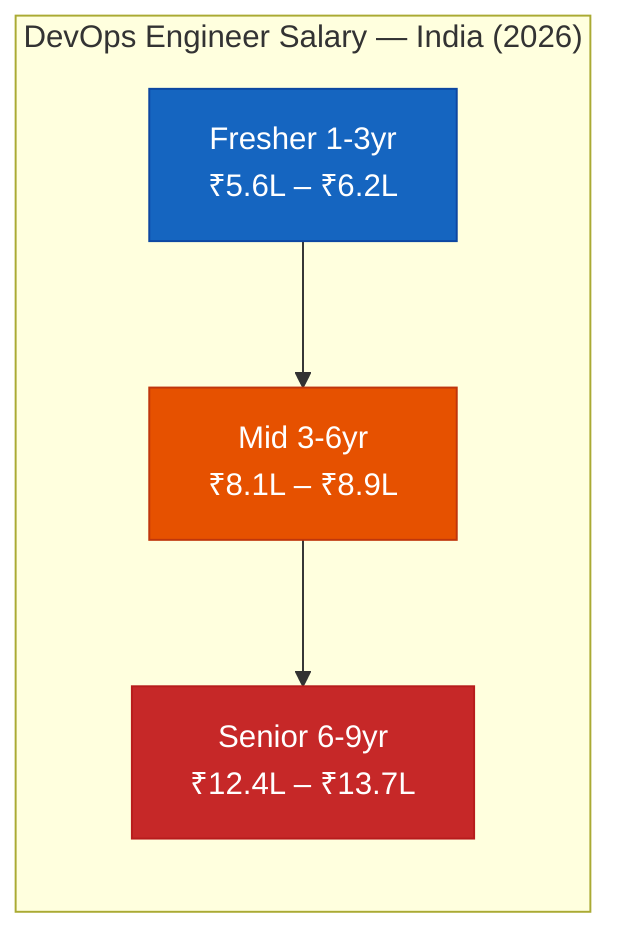

| Experience | Annual Salary Range (INR) | Salary Reports |
|---|---|---|
| 1–3 Years | ₹5.6 LPA – ₹6.2 LPA | 21,100 salaries |
| 3–6 Years | ₹8.1 LPA – ₹8.9 LPA | 84,200 salaries |
| 6–9 Years | ₹12.4 LPA – ₹13.7 LPA | 5,400 salaries |
| **Typical (2–6 yr)** | **₹8.3 LPA – ₹9.2 LPA** | 1.1 Lakh total |

**Top Paying Industries (India):**

| Industry | Salary Range |
|---|---|
| Financial Services | ₹12.5L – ₹13.8L |
| Software Product | ₹11.7L – ₹13.0L |
| Internet | ₹11.3L – ₹12.5L |
| Telecom | ₹9.9L – ₹11.0L |
| IT Services & Consulting | ₹7.6L – ₹8.4L |

**Top Paying Indian Cities:**

| City | Salary Range | Salary Reports |
|---|---|---|
| Bengaluru | ₹8.4L – ₹9.3L | 38,100 |
| Hyderabad | ₹8.0L – ₹8.8L | 28,700 |
| Pune | ₹8.1L – ₹8.9L | 11,300 |
| Chennai | ₹7.7L – ₹8.5L | 7,800 |
| Mumbai | ₹7.7L – ₹8.5L | 3,100 |

**Major Employers (India):**

| Company | Salary Range | Reports |
|---|---|---|
| IBM | ₹9.7L – ₹10.7L | 1,900 |
| Accenture | ₹7.6L – ₹8.3L | 2,900 |
| Wipro | ₹7.2L – ₹8.0L | 3,100 |
| Capgemini | ₹7.3L – ₹8.1L | 2,600 |
| Cognizant | ₹7.3L – ₹8.0L | 2,400 |
| Infosys | ₹7.0L – ₹7.7L | 2,100 |
| TCS | ₹5.9L – ₹6.6L | 8,000 |

---

### Salary Data — Europe & United Kingdom

| Country/Region | Level | Average Annual Salary | Source |
|---|---|---|---|
| **UK** | Junior DevOps | £35,000 – £45,000 | Glassdoor (2026) |
| **UK** | Mid-level DevOps | £55,000 – £75,000 | Glassdoor |
| **UK** | Senior DevOps / SRE | £80,000 – £110,000+ | Glassdoor |
| **Germany** | DevOps Engineer | €55,000 – €85,000 | StepStone |
| **Netherlands** | DevOps Engineer | €50,000 – €80,000 | Glassdoor |
| **France** | DevOps Engineer | €42,000 – €65,000 | Glassdoor |
| **Remote (EU)** | Senior DevOps | €70,000 – €100,000+ | levels.fyi |

| Key Insight | Detail |
|---|---|
| UK vs US Gap | UK salaries typically 30-40% lower than US equivalents |
| EU Convergence | Western EU converging on €60-80K median for mid-level |
| Remote Premium | EU-based working for US companies: 20-50% salary uplift |
| Certifications | CKA + AWS SA = strongest salary multiplier in EU market |

---

### Most In-Demand Skills (2026)

```mermaid
graph TB
    subgraph "Top DevOps Skills by Demand"
        S1["Python<br/>54.3K jobs"]
        S2["AWS<br/>22.5K jobs"]
        S3["Cloud<br/>18.2K jobs"]
        S4["Linux<br/>14.7K jobs"]
        S5["DevOps<br/>12.2K jobs"]
        S6["Docker<br/>7.7K jobs"]
        S7["Kubernetes<br/>7.3K jobs"]
        S8["Terraform<br/>5K+ jobs"]
        S9["Jenkins<br/>4K+ jobs"]
        S10["Ansible<br/>3K+ jobs"]
    end

    S1 --> S2 --> S3 --> S4 --> S5
    S5 --> S6 --> S7 --> S8 --> S9 --> S10

    style S1 fill:#1565c0,stroke:#0d47a1,color:#ffffff
    style S2 fill:#e65100,stroke:#bf360c,color:#ffffff
    style S3 fill:#0277bd,stroke:#01579b,color:#ffffff
    style S4 fill:#2e7d32,stroke:#1b5e20,color:#ffffff
    style S5 fill:#c62828,stroke:#b71c1c,color:#ffffff
    style S6 fill:#1565c0,stroke:#0d47a1,color:#ffffff
    style S7 fill:#0277bd,stroke:#01579b,color:#ffffff
    style S8 fill:#6a1b9a,stroke:#4a148c,color:#ffffff
    style S9 fill:#283593,stroke:#1a237e,color:#ffffff
    style S10 fill:#ad1457,stroke:#880e4f,color:#ffffff
```

> Data from AmbitionBox India, February 2026. Similar patterns globally — Python, AWS, Docker, Kubernetes, and Terraform dominate.

---

### Key Job Market Insights

| Insight | Detail |
|---|---|
| 🚀 **Growth Rate** | DevOps market growing at ~24% CAGR, one of the fastest in tech |
| 💰 **Premium over SW Dev** | DevOps engineers earn ~10-20% more than general software developers |
| 🌍 **Remote Friendly** | ~40-60% of DevOps roles offer remote/hybrid options globally |
| 📈 **Demand > Supply** | Persistent skills shortage — companies struggle to find experienced DevOps talent |
| 🎯 **Fastest Path to High Pay** | Cloud certifications (AWS/Azure) + Kubernetes (CKA) = highest salary multiplier |
| 🏢 **Industry Spread** | DevOps is no longer just tech — Finance, Healthcare, Govt, Manufacturing all hiring |
| 🤖 **AI/ML Boost** | MLOps and AIOps roles command 20-40% premium over traditional DevOps |
| 📊 **Experience Multiplier** | India: 6-9yr exp earns ~2.2x vs 1-3yr; USA: Senior earns ~1.5x vs entry-level |

> ⚡ **Key Takeaway:** DevOps is one of the most in-demand, highest-paid, and fastest-growing tech careers globally. The combination of cloud + containers + automation skills creates a highly employable profile across all industries.

> 🔗 **Sources:**
> - Indeed US — https://www.indeed.com/career/devops-engineer/salaries
> - AmbitionBox India — https://www.ambitionbox.com/profile/devops-engineer-salary
> - U.S. Bureau of Labor Statistics — https://www.bls.gov/ooh/computer-and-information-technology/software-developers.htm

---

## Summary Statistics

| Metric | Count |
|---|---|
| **Phases** | 15 (Phase 0–14) |
| **Major Topics** | 68 |
| **Subtopics** | 380+ |
| **Individual Learning Points** | 650+ |
| **Mermaid Diagrams** | 21 |
| **Reference Links** | 90+ |
| **Recommended Books** | 11 |
| **Certifications Mapped** | 7 |
| **Project Ideas** | 10 |
| **Tools Covered** | 130+ |
| **Job Market Data Points** | 60+ |
| **DORA Metrics** | 4 Key Metrics |
| **Salary Markets Covered** | 4 (US, India, UK, EU) |

---

> **Last Updated:** February 2026 | **Aligned with:** roadmap.sh, CNCF Landscape, AWS/Azure/GCP Certification Paths, Google SRE Book

---

*This index is a living document. Update it as the DevOps landscape evolves.*
